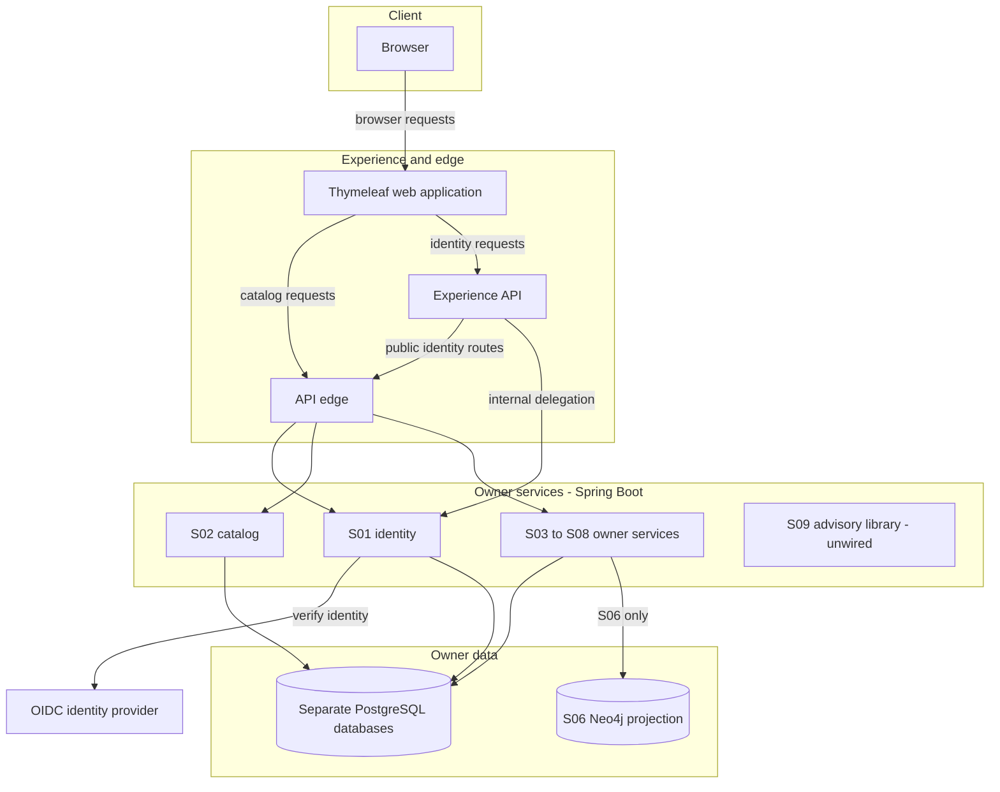
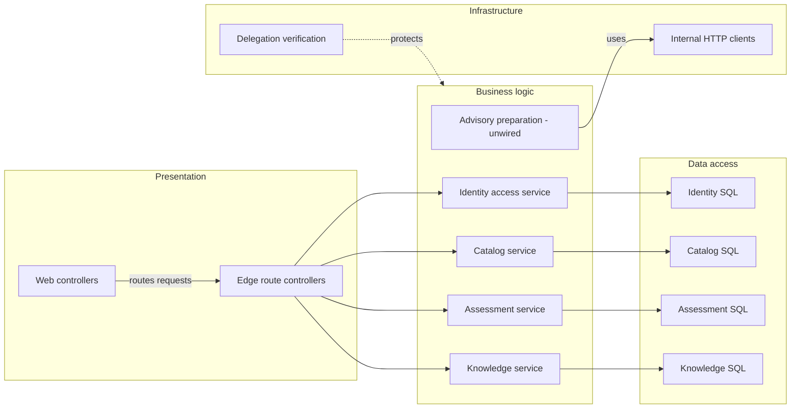

# Architecture Diagram

This view summarizes the current code structure, not the complete MS01 target.
The [implementation status](../../../../../docs/IMPLEMENTATION_STATUS.md) records
which capabilities are incomplete.

## Application Architecture

<!-- mermaid-checked: no \n, no em-dash/en-dash, no {} in labels, subgraphs are id["label"], arrows are -->|"label"|, all subgraphs closed by end, ids unique -->

### Technology Stack Summary

| Layer | Technology | Version | Purpose |
|---|---|---|---|
| Runtime | Java, Spring Boot | 25, 4.1.2 | Separately built service modules |
| Web | Thymeleaf | Managed by Spring Boot | Browser-facing pages |
| Owner state | PostgreSQL | Deployment-specific | Service-owned transactional records |
| Graph | Neo4j | 5.26 in local Compose | S06 graph projection |
| Identity | OIDC, Keycloak | 26.8.2 in local Compose | Authentication; S01 owns grants |

### Data Storage & External Services

Local Compose provides separate PostgreSQL instances, a Neo4j projection and
Keycloak. The advisory module is an unwired library; its simulated gateways
are not qualified for live provider dispatch.

### Key Architectural Decisions

- Each owner controls its database, migrations and domain decisions.
- Current identity and source checks do not authorize a new advisory run.

## Component Relationships

<!-- mermaid-checked: no \n, no em-dash/en-dash, no {} in labels, subgraphs are id["label"], arrows are -->|"label"|, all subgraphs closed by end, ids unique -->

### Component Inventory

| Component | Layer | Type | Responsibility |
|---|---|---|---|
| Edge route controllers | Presentation | Spring controllers | Route supported public requests |
| Identity and catalog services | Business logic | Owner services | Grants and workload inventory |
| Assessment and knowledge services | Business logic | Owner services | Cases and reviewed retrieval |
| Advisory preparation | Business logic | Unwired library | Point-in-time consistency checks |
| Owner SQL | Data access | JDBC and migrations | Independent owner persistence |
| Delegation verification | Infrastructure | Security library | Validate scoped service tokens |
