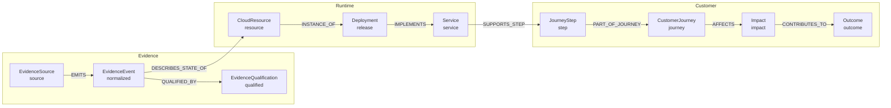
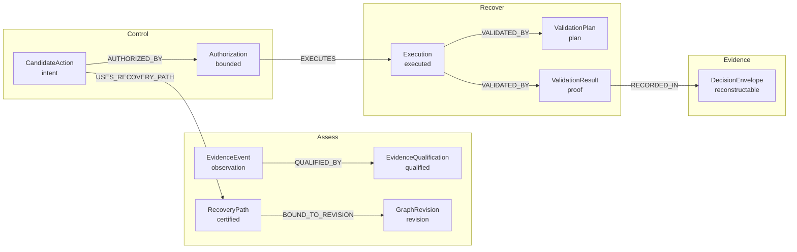

# Technical-approach diagram previews

These are zoomable Mermaid previews of two historical graph-vocabulary examples.
They show possible typed relationships, not current runtime behavior or proof
that a particular observation is qualified. The [data dictionary](../data-dictionary/)
defines the endpoint roles; [implementation status](../../../docs/IMPLEMENTATION_STATUS.md)
records what is actually implemented.

The source files remain editable separately; the sample-data tests check that
the previews below match their corresponding sources and that the labeled
relationship endpoints match the dictionary. Other Mermaid sources and the
[archival images](../diagrams/) are not covered by that preview check.

## Evidence to outcome

Source: [02_evidence_to_outcome.mmd](02_evidence_to_outcome.mmd).

## Recovery relationships

Source: [04_recovery_propagation.mmd](04_recovery_propagation.mmd).
This depicts graph relationships, not a recovery execution sequence.

