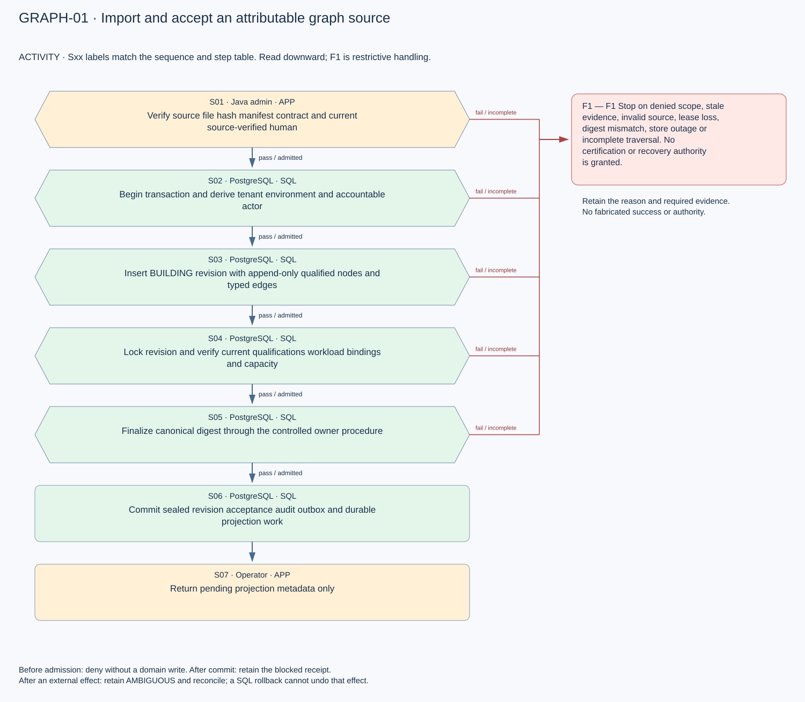
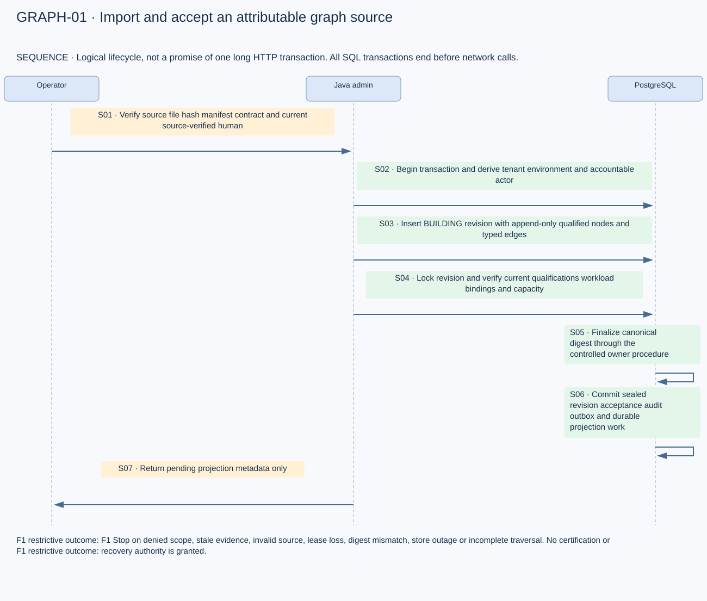
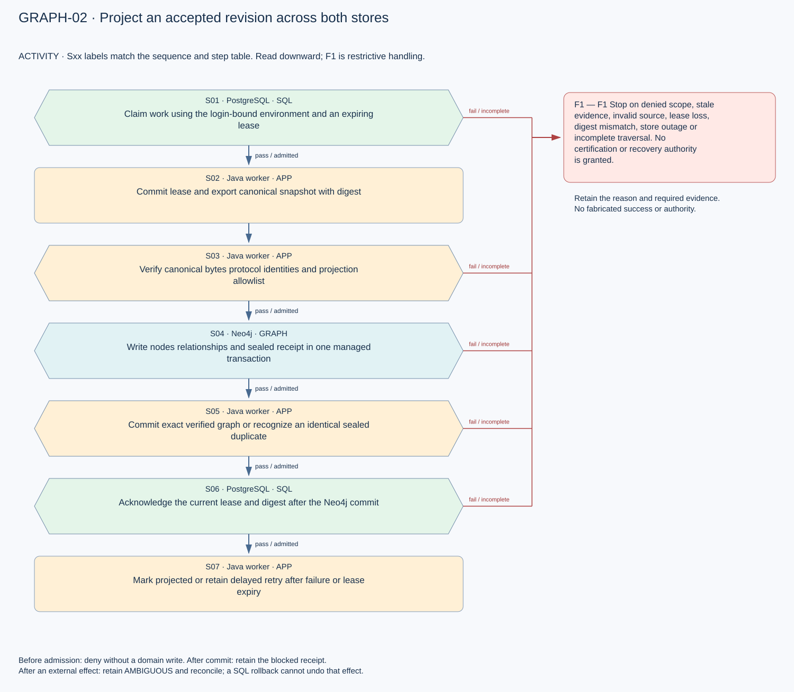
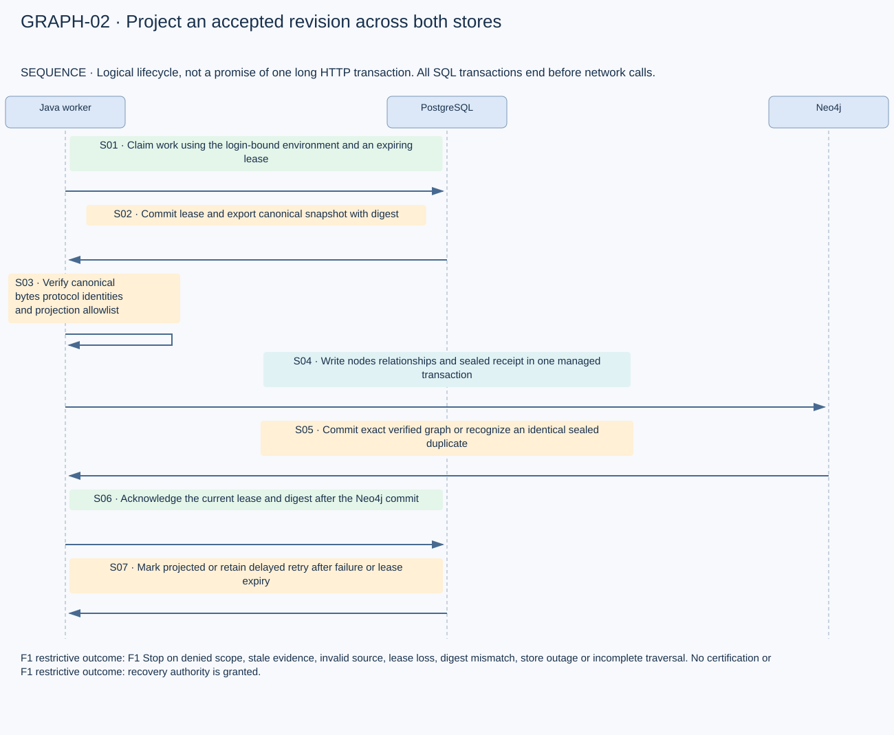
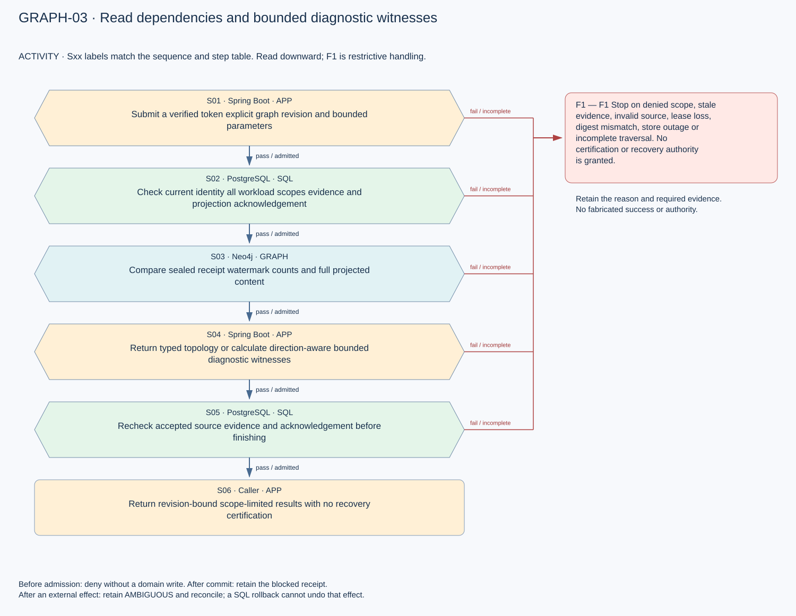
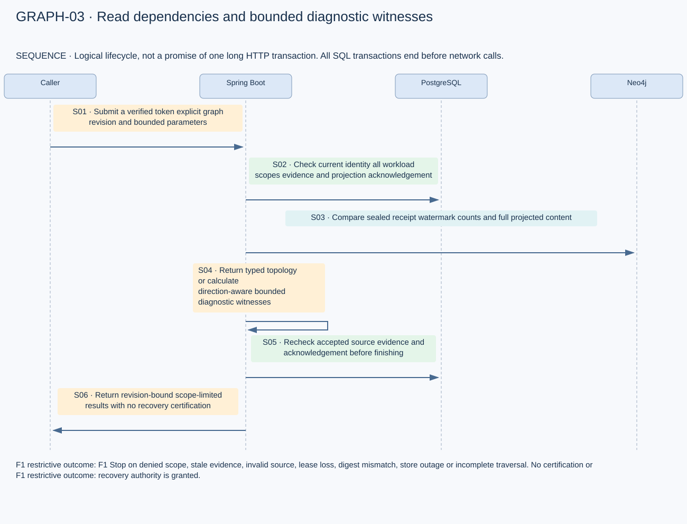

# Graph implementation activity and sequence diagrams

Version 1.0 · Flow revision 8. Three additional lifecycle pairs are separate from the 90 baseline flows. The Java worker uses independent database transactions with a durable SQL lease and acknowledgement; no distributed atomicity is claimed.

## Import and accept an attributable graph source

[Editable activity](mermaid/GRAPH-01_activity.mmd) · [Editable sequence](mermaid/GRAPH-01_sequence.mmd)

| Step | From | To | Action |
|---|---|---|---|
| S01 | Operator | Java admin | Verify source file hash manifest contract and current source-verified human |
| S02 | Java admin | PostgreSQL | Begin transaction and derive tenant environment and accountable actor |
| S03 | Java admin | PostgreSQL | Insert BUILDING revision with append-only qualified nodes and typed edges |
| S04 | Java admin | PostgreSQL | Lock revision and verify current qualifications workload bindings and capacity |
| S05 | PostgreSQL | PostgreSQL | Finalize canonical digest through the controlled owner procedure |
| S06 | PostgreSQL | PostgreSQL | Commit sealed revision acceptance audit outbox and durable projection work |
| S07 | Java admin | Operator | Return pending projection metadata only |

F1 Stop on denied scope, stale evidence, invalid source, lease loss, digest mismatch, store outage or incomplete traversal. No certification or recovery authority is granted.

## Project an accepted revision across both stores

[Editable activity](mermaid/GRAPH-02_activity.mmd) · [Editable sequence](mermaid/GRAPH-02_sequence.mmd)

| Step | From | To | Action |
|---|---|---|---|
| S01 | Java worker | PostgreSQL | Claim work using the login-bound environment and an expiring lease |
| S02 | PostgreSQL | Java worker | Commit lease and export canonical snapshot with digest |
| S03 | Java worker | Java worker | Verify canonical bytes protocol identities and projection allowlist |
| S04 | Java worker | Neo4j | Write nodes relationships and sealed receipt in one managed transaction |
| S05 | Neo4j | Java worker | Commit exact verified graph or recognize an identical sealed duplicate |
| S06 | Java worker | PostgreSQL | Acknowledge the current lease and digest after the Neo4j commit |
| S07 | PostgreSQL | Java worker | Mark projected or retain delayed retry after failure or lease expiry |

F1 Stop on denied scope, stale evidence, invalid source, lease loss, digest mismatch, store outage or incomplete traversal. No certification or recovery authority is granted.

## Read dependencies and bounded diagnostic witnesses

[Editable activity](mermaid/GRAPH-03_activity.mmd) · [Editable sequence](mermaid/GRAPH-03_sequence.mmd)

| Step | From | To | Action |
|---|---|---|---|
| S01 | Caller | Spring Boot | Submit a verified token explicit graph revision and bounded parameters |
| S02 | Spring Boot | PostgreSQL | Check current identity all workload scopes evidence and projection acknowledgement |
| S03 | Spring Boot | Neo4j | Compare sealed receipt watermark counts and full projected content |
| S04 | Spring Boot | Spring Boot | Return typed topology or calculate direction-aware bounded diagnostic witnesses |
| S05 | Spring Boot | PostgreSQL | Recheck accepted source evidence and acknowledgement before finishing |
| S06 | Spring Boot | Caller | Return revision-bound scope-limited results with no recovery certification |

F1 Stop on denied scope, stale evidence, invalid source, lease loss, digest mismatch, store outage or incomplete traversal. No certification or recovery authority is granted.
