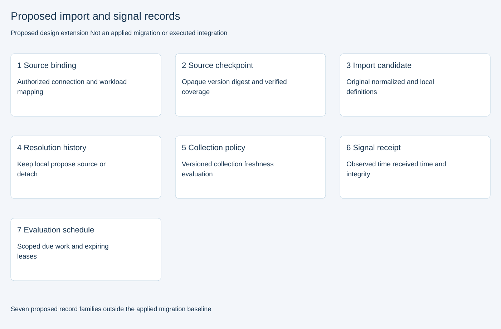
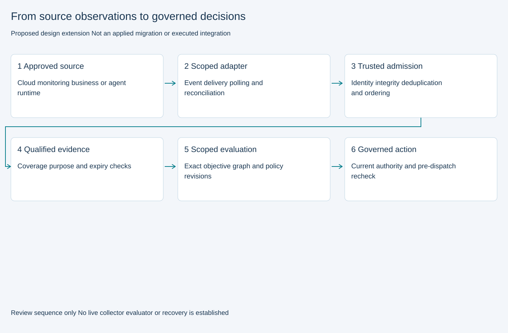

# Objective imports signals and decision timing

Version 1.0 · Guide revision 13 · Proposed import and signal extension revision 1

## What comes from a source and what comes from the business

Cloud and monitoring systems report what is happening: response times, errors, deployment changes and permission changes. An approved objective says what the service or agent must achieve. UACRF can import that objective from an existing tool or let an accountable owner propose it locally.

The customer journey explains why the objective matters and which workloads support the customer outcome. It does not supply measurements or invent targets. The source of an objective definition and the evidence used to measure it are separate records.

## Import an existing objective without losing its meaning

A connector is the integration component that reads an approved external system. For each imported objective, retain the source system, external identifier and source version. Also retain a digital fingerprint of the source content, so later reviewers can establish exactly what was read. A separate fingerprint identifies the definition after conversion into UACRF terms.

Record when the source definition changed, if known; when the connector last verified it; and when UACRF received it. Keep the mapping and conversion software versions. The server establishes the tenant, environment and authenticated actor. A name supplied in a message is not proof of identity.

Map the definition to the correct service or agent, metric, unit and measurement window. For example, 720 seconds can become 12 minutes through an approved conversion. Do not silently change a percentage, percentile, comparison direction or calendar window. Keep the original content in controlled storage. Unsupported or incomplete definitions wait for review rather than becoming active targets.

## Compare source changes with local changes

Compare three definitions: the last agreed source definition, the incoming source definition and the current local definition. Identical content is an unchanged import. If source and local definitions changed differently, retain a conflict rather than choosing a winner automatically.

The owner can keep the local definition, prepare a proposal from the source or detach source tracking. Record the choice, reason and exact versions. Check those versions again before accepting the proposal, because another update may have arrived during review.

An imported proposal follows the existing independent review and effective-date process. Delivery by a connector does not approve or activate it. Older evaluations retain their original objective and source references.

## Handle source loss and withdrawal explicitly

An objective missing from a partial scan is not necessarily deleted. Treat it as withdrawn only when the source explicitly reports removal or a complete, authoritative comparison establishes it. Preserve the history and ask the accountable owner to review the linked definition.

A failed synchronization, revoked permission or stale source check does not prove that the target changed. It also does not justify presenting the external definition as current. Apply the evidence rules and show an Unknown or otherwise restrictive conclusion where needed. Authorized containment and human escalation can still remain available.

## Receive operational signals through trusted admission

Connectors receive source events where available and periodically check for missed changes. They translate native identifiers into the correct tenant, environment and workload, then submit observations through the existing evidence or protected-agent admission contracts.

Retain the event identifier, source version or sequence, observation time, receipt time and content fingerprint. Verify who produced the signal, whether its bytes match the fingerprint and whether its coverage is complete. Late, conflicting or incorrectly mapped data must not silently replace newer context.

A repeated delivery must not create another observation, tool dispatch or charge. An admitted observation is still only an observation; separate checks determine whether it is sufficient evidence for a particular decision.

## Use three separate clocks

Collection timing determines when a connector receives or requests data. Freshness determines how old that data may be for the decision at hand. Evaluation timing determines when UACRF applies its rules. These are separate settings.

For operational signals, calculate age from the source observation time. A late arrival must not make an old observation look new. Polling more frequently cannot create measurements that the source has not produced.

For a stable objective definition, use the last successful source verification instead of the definition's original creation date. An unchanged definition can still be current. Configuration also needs a verified snapshot or attributable change stream; failed checking cannot establish that old configuration is still valid.

## Choose feasible starting intervals

The timing register contains starting examples, not provider guarantees. Metrics use source events plus 30-second polling, with a five-minute reconciliation check and a two-minute freshness limit. Reconciliation means checking the source again to find changes that event delivery may have missed. Routine metric evaluation uses a five-minute observation window.

Configuration uses change events plus five-minute polling and fifteen-minute reconciliation. Objective definitions use source changes plus fifteen-minute checks and hourly reconciliation. Their freshness depends on the last successful verification. Agent runtimes report admission, dispatch, completion, timeout, cancellation and handoff as events; reconciliation and expiry checks expose missing events.

Choose the actual settings for the workload and source. Consider source resolution, delivery delay, criticality, cost and quotas. A freshness limit shorter than the polling interval needs reliable event delivery to fill the gap. If the source cannot support the target, change the plan rather than claim coverage.

## Evaluate meaningful changes and expired evidence

Reevaluate affected workloads when a target is breached, a material dependency changes, a permission is revoked, an agent fails, a budget runs out or an approved objective changes. Closing an observation window can also trigger evaluation. An expiry timer must trigger reevaluation even when no new signal arrives.

Routine observations can be grouped to avoid reacting to every small fluctuation. Urgent revocation, evidence expiry and containment events bypass that routine delay. Each evaluation retains the exact objective, graph, policy and evidence versions it used. An evaluation result does not grant permission to dispatch a recovery action.

## Check again before consequential action

Immediately before a consequential action, the worker checks current permissions, evidence freshness, the exact target and the bounded authorization. Agent brokers also enforce remaining steps, tokens, cost and deadline for each admitted call.

A recorded pause is not proof that a remote action stopped. Reconcile uncertain external effects before retrying or resuming a checkpoint. After recovery, test the actual customer, task, data and security outcomes for the required stable window. Use independent observations where an agent would otherwise be grading its own work.

## Make delivery failures visible

Use bounded retries and resumable source checkpoints so a failed connector can recover without skipping changes. Make missing coverage, late arrivals, duplicate conflicts and clock errors visible. Do not reuse a checkpoint after its source scope or permissions change.

Save accepted data, audit history and checkpoint movement together. An outbox is a database record of work that must be delivered after that save succeeds; it prevents a crash between saving a record and requesting its evaluation from losing the request.

Scheduled work also needs a temporary worker claim, called a lease. If the worker fails, another worker can reclaim it after expiry. A claim generation prevents an older worker from continuing with expired authority. These controls must be implemented and tested; a read query alone does not provide them.

## What is included and what still needs implementation

The new proposed extension contains nine strict schemas, eight API operations and seven storage record families. It includes read-query sketches, two editable sequence diagrams and two graphical design views. These are separate from the baseline: 74 canonical APIs, 102 business tables, 18 applied migration files, 338 named SQL building blocks and 90 implementation flows.

The earlier objective extension still has seven proposed operations and four record families. Neither extension is deployed. Both storage designs loaded in isolated PostgreSQL; the objective integrity slice also passed sequential trigger tests. Import worker and full extension acceptance remain pending. Both reuse the existing authorized connection and workload identities; this update does not implement a new connector registry.

The UI rehearses a fictional objective import conflict and lets the reader prepare a provider-scoped timing plan. It does not fetch external definitions, run collectors or timers, or change active objectives.

## Acceptance required before promotion

Before promotion, implement and test the connectors and controlled transactions. Check duplicate deliveries, concurrent edits, units and measurement windows, source withdrawals, partial scans, revoked permissions, late signals and clock errors. Exercise expiry during silence, urgent evaluation, abandoned worker claims and recovery after a collector crash.

Then test real GCP, AWS, Azure, monitoring and agent-runtime integrations for their source resolution, quotas, paging and failure behavior. Measure delivery and decision latency under load before making promises. Browser, accessibility, live integration and full system acceptance remain pending. Design alignment and test planning do not raise readiness scores.

## Reading the artifacts

[Proposed API](openapi.proposed.json), [timing examples](TIMING_EXAMPLES.json), [proposed storage](storage.proposed.sql), [read sketches](queries.proposed.sql), [import sequence](objective-import-sequence.mmd) and [signal sequence](signal-decision-sequence.mmd) are implementation designs. The graphical views below are separate from the baseline schema explorer and canonical flow diagrams.

## Mapping and acceptance detail

A normalized objective preserves comparison direction, measurement kind and percentile where relevant. It does not contain administrator template minimum or maximum rules. Source imports cannot create or weaken those rules. Proposal admission requires the exact current approved template reference and source digest. Unsupported conversions, nonterminating results without an approved rounding policy and incompatible windows require review. The finite reference examples illustrate these checks; they do not implement a connector or trusted worker.

The source binding uses the existing scoped connection and service records. Connection, workload and binding references are represented in the proposed storage. A source binding must have a stable identity across revisions; workers serialize updates for the external objective/workload key. Scheduler leases require fencing generations and bounded retries. The proposed SQL grants no application access until controlled procedures and tests are implemented.

The proposed SQL first creates its seven record families, then adds an optional scoped import origin to the earlier proposed objective revision table. Apply neither file to a shared database: isolated engine review must establish dependency order, transactional behavior and constraint coverage before promotion. See STORAGE_DICTIONARY.json for the separate design dictionary.

Connection configuration revisions are retained with bindings, collection policies and signal receipts. Workers compare a queued operation with the current authorized configuration before fetching or accepting data; a connection identifier alone does not make an old configuration current. The import-origin reference is optional for manually defined objectives and complete for imported proposals.

## Implementation review 1

The current review distinguishes design coverage from completed application behavior. Of 74 canonical operations, 29 have machine-readable API contracts and 45 still need complete wire contracts. The existing bundles now include typed response projections. Objective templates specify comparison, measurement type and conditional percentile, with exact window and unit retained in local proposals. The proposed integrity patch adds submission and lifecycle guards, but controlled procedures, persistent reasons, mandatory-rule bindings, source checks and production privileges remain open. Nineteen sequential objective assertions supplement the rerun baseline database evidence. No readiness score changes.

The earlier flow notes describe 90 baseline flows, 180 diagrams and revision-specific implementation gates. Treat those counts and architecture/database labels as historical; diagrams do not establish executed HTTP handlers or acceptance.

For current implementation and test status, read the [runtime gap-closure report](../runtime/GAP_CLOSURE.md), [verification snapshot guide](../verification/README.md) and [integration test plan](../verification/INTEGRATION_TEST_PLAN.md).
