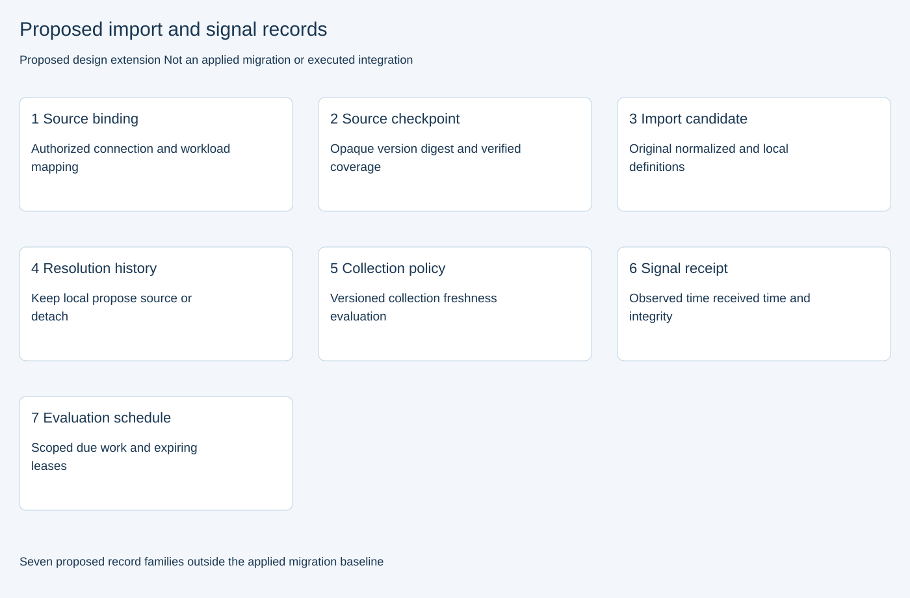
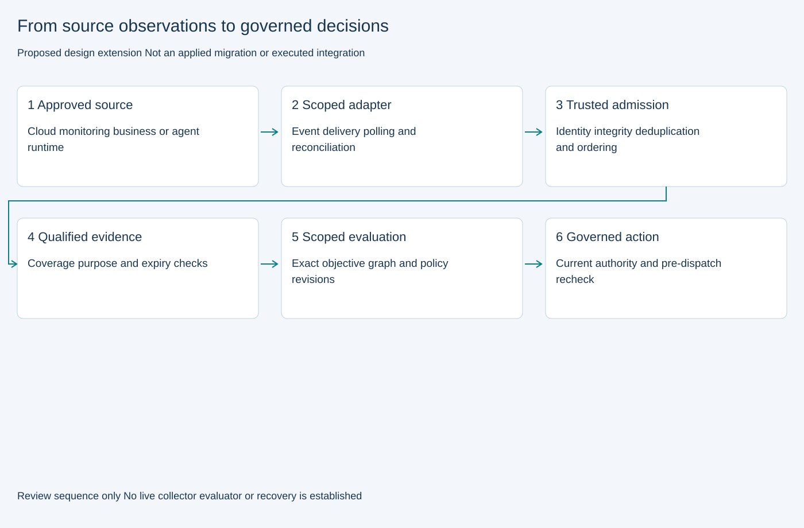

# Objective imports signals and decision timing

Version 1.0 · Guide revision 13 · Proposed import and signal extension revision 1

## What comes from a source and what comes from the business

Cloud and monitoring systems report what is happening: response times, errors, deployment changes and permission changes. An approved objective says what the service or agent must achieve. UACRF can import that objective from an existing tool or let an accountable owner propose it locally.

The customer journey explains why the objective matters and which workloads support the customer outcome. It does not supply measurements or invent targets. The source of an objective definition and the evidence used to measure it are separate records.

## Import an existing objective without losing its meaning

A connector is the integration component that reads an approved external system. For each imported objective, retain the source system, external identifier and source version. Also retain a digital fingerprint of the source content, so later reviewers can establish exactly what was read. A separate fingerprint identifies the definition after conversion into UACRF terms.

Record when the source definition changed, if known; when the connector last verified it; and when UACRF received it. Keep the mapping and conversion software versions. The server establishes the tenant, environment and authenticated actor. A name supplied in a message is not proof of identity.

Map the definition to the correct service or agent, metric, unit and measurement window. For example, 720 seconds can become 12 minutes through an approved conversion. Do not silently change a percentage, percentile, comparison direction or calendar window. Keep the original content in controlled storage. Unsupported or incomplete definitions wait for review rather than becoming active targets.

## Compare source changes with local changes

Compare three definitions: the last agreed source definition, the incoming source definition and the current local definition. Identical content is an unchanged import. If source and local definitions changed differently, retain a conflict rather than choosing a winner automatically.

The owner can keep the local definition, prepare a proposal from the source or detach source tracking. Record the choice, reason and exact versions. Check those versions again before accepting the proposal, because another update may have arrived during review.

An imported proposal follows the existing independent review and effective-date process. Delivery by a connector does not approve or activate it. Older evaluations retain their original objective and source references.

## Handle source loss and withdrawal explicitly

An objective missing from a partial scan is not necessarily deleted. Treat it as withdrawn only when the source explicitly reports removal or a complete, authoritative comparison establishes it. Preserve the history and ask the accountable owner to review the linked definition.

A failed synchronization, revoked permission or stale source check does not prove that the target changed. It also does not justify presenting the external definition as current. Apply the evidence rules and show an Unknown or otherwise restrictive conclusion where needed. Authorized containment and human escalation can still remain available.

## Receive operational signals through trusted admission

Connectors receive source events where available and periodically check for missed changes. They translate native identifiers into the correct tenant, environment and workload, then submit observations through the existing evidence or protected-agent admission contracts.

Retain the event identifier, source version or sequence, observation time, receipt time and content fingerprint. Verify who produced the signal, whether its bytes match the fingerprint and whether its coverage is complete. Late, conflicting or incorrectly mapped data must not silently replace newer context.

A repeated delivery must not create another observation, tool dispatch or charge. An admitted observation is still only an observation; separate checks determine whether it is sufficient evidence for a particular decision.

## Use three separate clocks

Collection timing determines when a connector receives or requests data. Freshness determines how old that data may be for the decision at hand. Evaluation timing determines when UACRF applies its rules. These are separate settings.

For operational signals, calculate age from the source observation time. A late arrival must not make an old observation look new. Polling more frequently cannot create measurements that the source has not produced.

For a stable objective definition, use the last successful source verification instead of the definition's original creation date. An unchanged definition can still be current. Configuration also needs a verified snapshot or attributable change stream; failed checking cannot establish that old configuration is still valid.

## Choose feasible starting intervals

The timing register contains starting examples, not provider guarantees. Metrics use source events plus 30-second polling, with a five-minute reconciliation check and a two-minute freshness limit. Reconciliation means checking the source again to find changes that event delivery may have missed. Routine metric evaluation uses a five-minute observation window.

Configuration uses change events plus five-minute polling and fifteen-minute reconciliation. Objective definitions use source changes plus fifteen-minute checks and hourly reconciliation. Their freshness depends on the last successful verification. Agent runtimes report admission, dispatch, completion, timeout, cancellation and handoff as events; reconciliation and expiry checks expose missing events.

Choose the actual settings for the workload and source. Consider source resolution, delivery delay, criticality, cost and quotas. A freshness limit shorter than the polling interval needs reliable event delivery to fill the gap. If the source cannot support the target, change the plan rather than claim coverage.

## Evaluate meaningful changes and expired evidence

Reevaluate affected workloads when a target is breached, a material dependency changes, a permission is revoked, an agent fails, a budget runs out or an approved objective changes. Closing an observation window can also trigger evaluation. An expiry timer must trigger reevaluation even when no new signal arrives.

Routine observations can be grouped to avoid reacting to every small fluctuation. Urgent revocation, evidence expiry and containment events bypass that routine delay. Each evaluation retains the exact objective, graph, policy and evidence versions it used. An evaluation result does not grant permission to dispatch a recovery action.

## Check again before consequential action

Immediately before a consequential action, the worker checks current permissions, evidence freshness, the exact target and the bounded authorization. Agent brokers also enforce remaining steps, tokens, cost and deadline for each admitted call.

A recorded pause is not proof that a remote action stopped. Reconcile uncertain external effects before retrying or resuming a checkpoint. After recovery, test the actual customer, task, data and security outcomes for the required stable window. Use independent observations where an agent would otherwise be grading its own work.

## Make delivery failures visible

Use bounded retries and resumable source checkpoints so a failed connector can recover without skipping changes. Make missing coverage, late arrivals, duplicate conflicts and clock errors visible. Do not reuse a checkpoint after its source scope or permissions change.

Save accepted data, audit history and checkpoint movement together. An outbox is a database record of work that must be delivered after that save succeeds; it prevents a crash between saving a record and requesting its evaluation from losing the request.

Scheduled work also needs a temporary worker claim, called a lease. If the worker fails, another worker can reclaim it after expiry. A claim generation prevents an older worker from continuing with expired authority. These controls must be implemented and tested; a read query alone does not provide them.

## What is included and what still needs implementation

The new proposed extension contains nine strict schemas, eight API operations and seven storage record families. It includes read-query sketches, two editable sequence diagrams and two graphical design views. These are separate from the baseline: 74 canonical APIs, 102 business tables, 18 applied migration files, 338 named SQL building blocks and 90 implementation flows.

S05 implements durable admission of objective preview: an authorized `POST /v1/objective-imports:preview` stores an idempotent request and outbox event, and `GET /v1/objective-imports/{id}` reads its pending receipt. API Edge routes both operations. A separate opt-in S05 read can inspect the bound fictional source for a pending request through S01 and S03 without retaining it. An explicit, idempotent S05 capture operation can retain that fictional payload and its versioned fingerprint as an immutable, unverified historical observation. EDGE01 forwards capture, and UX01 offers it from the inspection page with a warning that capture refetches the source and may differ from the inspected view. The context-bound retry preserves the key; source reauthorization or availability can still prevent replay. S05 can read a known capture and its exact retained payload with global objective-read authority, without refetching the source; EDGE01 forwards that read. The browser receipt links to the escaped exact payload and versioned fingerprint, validates the payload digest, and labels the observation unverified and historical. S05 lists bounded capture summaries in capture-ID order; EDGE01 and UX01 expose that list with first/next navigation and disclose that pages are not a snapshot. Broader import history remains open. Neither operation validates a mapping, compares local definitions, or creates a candidate. No worker consumes the command yet, so the status stays `PENDING` and source verification is not established. The broader import/signal extension and the earlier seven-operation objective extension are not fully deployed or accepted. Both reuse the existing authorized connection and workload identities; this update does not implement a new connector registry.

S05 also contains a tested helper for exact seconds/minutes and explicitly enabled fraction/percent target conversions. It rejects incompatible windows, unsupported mappings, invalid ranges and conversions requiring rounding. It is not connected to import processing and does not itself approve mappings or verify provenance.

An additional typed definition validates the proposed normalized fields and preserves
metric, comparison, measurement kind, percentile, measurement reference and window
across those exact unit conversions. A standalone strict parser accepts the bounded
fictional sample payload format, rejects duplicate or unknown fields and preserves
decimal precision. The parser is not connected to a worker and does not establish an
approved mapping, retain provenance or process imports.

An S05 read-only rehearsal applies those exact conversions to a known
retained fictional capture, checks the stored payload and definition
fingerprints and returns original and hypothetical normalized definitions with
versioned fingerprints. It preserves the measurement window and labels the
result `UNAPPROVED_REHEARSAL` and `SYNTHETIC_UNVERIFIED`. It does not persist a
candidate, approve the selected conversion or reverify the source. EDGE01
forwards it and UX01 exposes the labeled hypothetical result through a
read-only form.

S05 can also retain an immutable, explicitly `UNAPPROVED` synthetic mapping
proposal for a specific retained capture. It records the selected conversion,
reason, actor and versioned original and hypothetical fingerprints, supports
idempotent retries while the request is pending, and is readable within the
authorized context. It relies on the incoming delegation rather than a fresh
membership check, does not reverify the source or approve a mapping, and does
not create a candidate or process an import. EDGE01 forwards proposal creation
and read, and UX01 exposes submission from the rehearsal and known-proposal
readback. S05 can list bounded proposal summaries for a known capture, with
context-bound cursors; EDGE01 forwards the list and UX01 provides first/next
navigation from the capture, with the same unverified historical limitations.
S05 can retain one
independent approval or rejection of the exact synthetic proposal after a
fail-closed current-reviewer check. The immutable
proposal remains marked `UNAPPROVED`; the separate decision is limited to the
historical fictional capture and is not trusted source provenance. The reviewer
check is not atomic with the S05 commit. EDGE01 forwards review admission and
known-review read without interpreting the decision. S05 exposes the zero or one
review for a known proposal, and EDGE01 forwards discovery. UX01 displays and
submits an independent synthetic decision with digest-bound, context-bound
retry. Real-provider mapping and import processing remain open.

S05 can retain an immutable normalized candidate for an independently approved
historical synthetic proposal. Admission binds the exact proposal digest and
revalidates the captured bytes and conversion; scoped reads validate the stored
normalized fingerprint. The candidate is `UNCOMPARED` and
`SYNTHETIC_UNVERIFIED`: it is not trusted provider provenance, a current
membership or source check, an approved general mapping, a local comparison,
an import resolution or an objective proposal. S05 discovers the zero or one
candidate for a known review; EDGE01 forwards admission, discovery and
known-candidate readback. UX01 links an approved review to discovery and
admission, re-reads the proposal and review before submission, and preserves
the context-bound form and idempotency key on uncertain outcomes.

S05 can compare an explicitly selected objective in the capture's workload
against a retained synthetic candidate without changing either record. It
reports exact metric, unit, comparison and, when units agree, target
differences. Legacy comparisons explicitly mark distinct window
representations and missing local measurement semantics as incomparable or
unavailable. On opt-in, retained local semantics are also compared: measurement
reference and kind exactly, percentiles numerically only for the same kind,
and positive ISO durations by duration value. Other source windows remain
incomparable. The
current local revision and existing lifecycle digest are context, not a
normalized-definition fingerprint. This is only a partial field comparison,
not a three-way import classification, source verification or resolution.
EDGE01 forwards the read; UX01 accepts an explicit objective ID and displays
validated, clearly labeled field results.

New local objectives may optionally retain a complete normalized definition
whose metric, exact target, unit, comparator and ISO duration agree with the
objective. S05 immutably binds its versioned fingerprint to the content digest
and provides scoped readback. Legacy records are not backfilled. EDGE01 forwards
the opt-in comparison and UX01 validates and displays its results; the separate
definition readback remains S05-only.

S05 also has a standalone `OBJECTIVE_DEFINITION_EXACT_DECIMAL_V1` fingerprint
for the eight normalized definition fields. Its SHA-256 input is UTF-8 compact
JSON with keys in alphabetical order, including a null percentile. Strings use
JSON escapes for quotes, backslashes and control characters, preserve valid
Unicode without normalization, and reject unpaired surrogates. Numbers are
exact decimal JSON numbers without exponents or redundant fractional zeros;
zero is `0`. Precision and scale are each bounded to 100. This is a versioned
exact-decimal format, not RFC 8785 floating-point number serialization. The
version must accompany any stored or compared digest; differing versions must
not be compared without an explicit migration. The existing fictional candidate
fixture matches. Pending-source inspection exposes this fingerprint for the
parsed fictional definition in its original units, and explicit synthetic
capture retains it with the original payload. It is not connected to an
approved mapping, import processing, source verification or trusted
provenance.

A standalone three-way digest classifier implements the finite comparison examples, preserving conflicts and treating incomplete or invalid scope as invalid even when withdrawal is claimed. Its digest values require the supported `OBJECTIVE_DEFINITION_EXACT_DECIMAL_V1` version; unknown versions and unversioned strings cannot be compared. It does not establish source completeness, verify withdrawal or read persisted definitions.

The UI rehearses a fictional objective import conflict and lets the reader prepare a provider-scoped timing plan. It does not fetch external definitions, run collectors or timers, or change active objectives.

## Acceptance required before promotion

Before promotion, implement and test the connectors and controlled transactions. Check duplicate deliveries, concurrent edits, units and measurement windows, source withdrawals, partial scans, revoked permissions, late signals and clock errors. Exercise expiry during silence, urgent evaluation, abandoned worker claims and recovery after a collector crash.

Then test real GCP, AWS, Azure, monitoring and agent-runtime integrations for their source resolution, quotas, paging and failure behavior. Measure delivery and decision latency under load before making promises. Browser, accessibility, live integration and full system acceptance remain pending. Design alignment and test planning do not raise readiness scores.

## Reading the artifacts

[Proposed API](openapi.proposed.json), [timing examples](TIMING_EXAMPLES.json), [proposed storage](storage.proposed.sql), [read sketches](queries.proposed.sql), [import sequence](objective-import-sequence.mmd) and [signal sequence](signal-decision-sequence.mmd) are implementation designs. The graphical views below are separate from the baseline schema explorer and canonical flow diagrams.

## Mapping and acceptance detail

A normalized objective preserves comparison direction, measurement kind and percentile where relevant. It does not contain administrator template minimum or maximum rules. Source imports cannot create or weaken those rules. Proposal admission requires the exact current approved template reference and source digest. Unsupported conversions, nonterminating results without an approved rounding policy and incompatible windows require review. The finite reference examples illustrate these checks; they do not implement a connector or trusted worker.

The source binding uses the existing scoped connection and service records. Connection, workload and binding references are represented in the proposed storage. A source binding must have a stable identity across revisions; workers serialize updates for the external objective/workload key. Scheduler leases require fencing generations and bounded retries. The proposed SQL grants no application access until controlled procedures and tests are implemented.

The proposed SQL first creates its seven record families, then adds an optional scoped import origin to the earlier proposed objective revision table. Apply neither file to a shared database: isolated engine review must establish dependency order, transactional behavior and constraint coverage before promotion. See STORAGE_DICTIONARY.json for the separate design dictionary.

Connection configuration revisions are retained with bindings, collection policies and signal receipts. Workers compare a queued operation with the current authorized configuration before fetching or accepting data; a connection identifier alone does not make an old configuration current. The import-origin reference is optional for manually defined objectives and complete for imported proposals.

## Implementation review 1

The current review distinguishes design coverage from completed application behavior. Of 74 canonical operations, 29 have machine-readable API contracts and 45 still need complete wire contracts. The existing bundles now include typed response projections. Objective templates specify comparison, measurement type and conditional percentile, with exact window and unit retained in local proposals. The proposed integrity patch adds submission and lifecycle guards, but controlled procedures, persistent reasons, mandatory-rule bindings, source checks and production privileges remain open. Nineteen sequential objective assertions supplement the rerun baseline database evidence. No readiness score changes.

The earlier flow notes describe 90 baseline flows, 180 diagrams and revision-specific implementation gates. Treat those counts and architecture/database labels as historical; diagrams do not establish executed HTTP handlers or acceptance.

For current implementation and test status, read the [runtime gap-closure report](../runtime/GAP_CLOSURE.md), [verification snapshot guide](../verification/README.md) and [integration test plan](../verification/INTEGRATION_TEST_PLAN.md).
