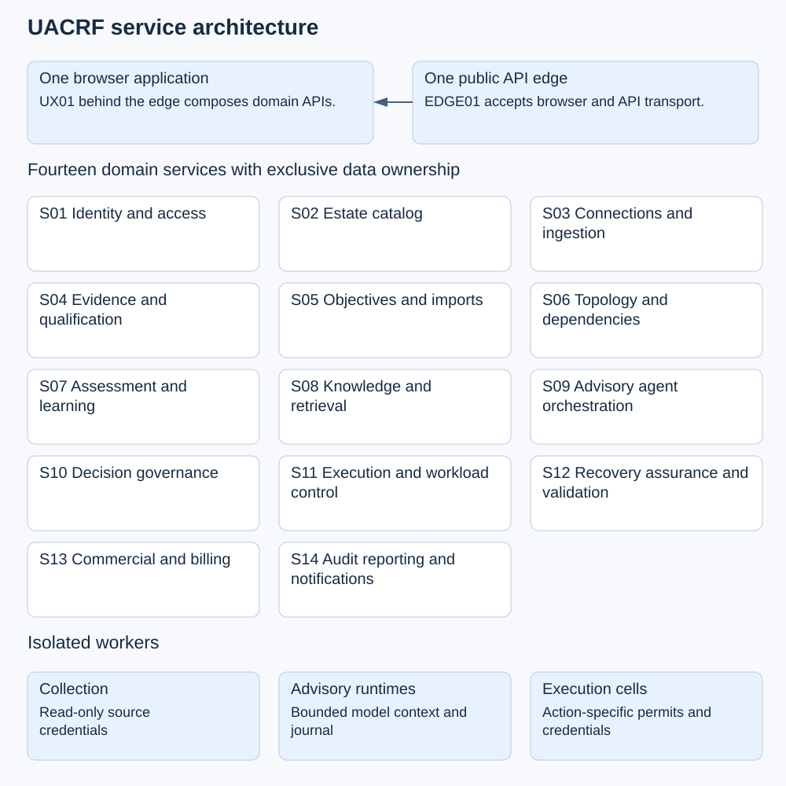
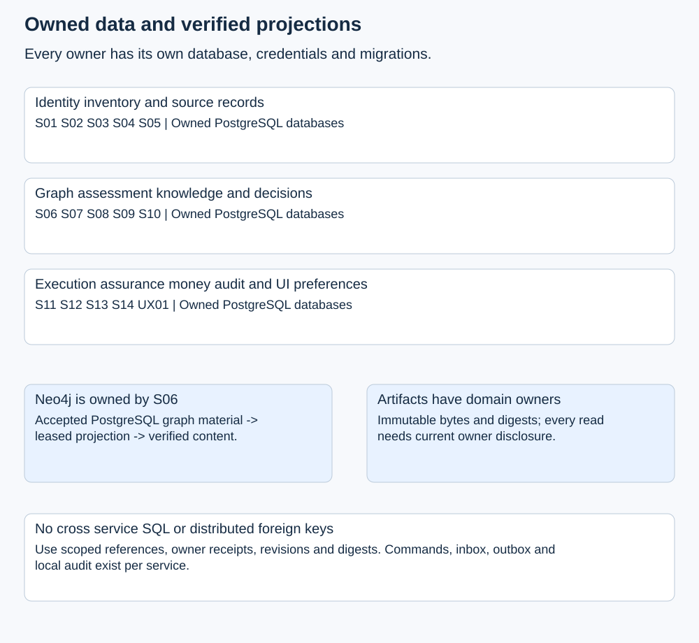
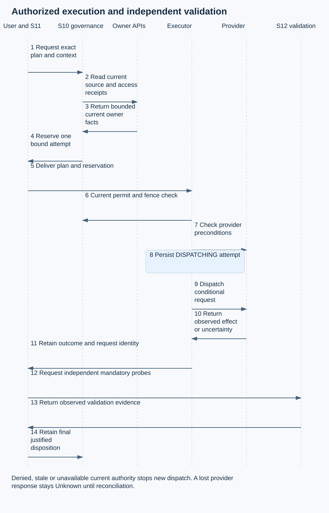

# UACRF microservices architecture and implementation design

Version 1.0 | Architecture revision MS 01 | 3 November 2026

## 1 Purpose and architectural decision

UACRF will be implemented as independently deployable Java Spring Boot services with clear ownership of their data and decisions. One browser application will guide customers through onboarding, inventory, objectives, evidence, assessment, advisory agents, authorized recovery and outcome review. PostgreSQL will retain authoritative transactional records. Neo4j will provide a separately verified dependency projection owned by the topology service.

The recommended target has fourteen domain services, one experience API and one API edge. A service boundary follows a business responsibility, a data owner and a failure or privilege boundary. It does not follow a screen, table or cloud provider. Services can share managed infrastructure while retaining separate databases, credentials, migrations and release lifecycles. Provider collection, model invocation and privileged execution run in isolated worker deployments behind explicit contracts.

The existing application is the migration source. Its Java calculations, strict artifact verification, bounded agent runtime, schemas and local tests are reusable. Its shared database functions, global environment lock and cross-domain foreign keys cannot simply be moved into separate processes. This design replaces those dependencies with owner APIs, retained evidence receipts, durable workflows and explicit execution fencing.

This package specifies the target and its implementation gates. It does not establish that the microservices already exist. Working documents remain Version 1.0; architecture revisions and execution evidence are recorded separately. The published paper, recovered originals and historical releases remain intact.

## 2 Source baseline and completeness boundary

The latest retained local application checkpoint passed 322 tests, including 204 runtime methods. The source JAR registers 107 routes. The older completion inventory still records 99 routes, 97 full operations, two partial routes and 44 unclosed operations from the original backlog. Five additional advisory operations have working locally tested implementations whose artifact promotion was unfinished. These different checkpoints must not be combined into a claim of complete delivery.

The architecture inventory contains 74 canonical operations and 70 other documented operations, for 144 unique method/path pairs. It assigns an owner to each. It also assigns migration ownership to 153 source table declarations and allocates all 131 requirement IDs. The table count comes from the installer source and its SQL files, not inspection of a deployed database. Some declarations represent local technical patterns that must be split across services rather than copied into one shared database.

The exact original 47 endpoints are retained in `inventories/ORIGINAL_47_DISPOSITION.json`. Previously completed operations also require migration and regression acceptance. A successful single-application test is reusable evidence about its behavior, not evidence that its distributed replacement works.

The thirty-nine existing integration scenarios remain planned full-system acceptance cases. They must be run against the target architecture, with provider-specific cases repeated for AWS, Azure and GCP where their semantics differ. No documentation score or production-readiness claim increases because this design exists.

## 3 Product scope and the paper loop

Services and agents are both first-class protected workloads. A protected agent can stand alone; it does not require the customer to invent a parent service. A compatibility service identity may remain internal while existing governance records are migrated. Journeys link either workload type to customer outcomes. Models, tools, knowledge, memory, identities, runtimes, data and handoffs are shared resources that can support agents, services or both.

UACRF assistance is a separate concern. Its advisory agents inspect evidence and recommendations under bounded assignments. Protecting a customer's agent workload does not promote UACRF assistance into automatic operational authority.

| Loop stage | Responsible services | Required implemented behavior and evidence |
|---|---|---|
| Observe | S03 S04 S06 | Attributable source observations, source-time freshness, quality decisions and accepted topology revisions |
| Detect | S05 S07 | Compare qualified measurements with approved targets; retain findings and Unknown when evidence is insufficient |
| Predict | S07 | Versioned forecasting or anomaly models, holdout evaluation, uncertainty, calibration and shadow comparison before operational use |
| Prevent | S10 S11 | Evaluate bounded candidate actions, obtain required independent approvals and admit only current authorized attempts |
| Withstand | S11 S12 | Enforced budgets, isolation, containment, degraded operation, agent control generations and evidence from fault exercises |
| Recover | S11 S12 | Attributable provider or runtime effects followed by independent probes against approved recovery criteria |
| Learn | S07 S12 S14 | Incident and experiment review, causal hypotheses, action owners, due dates, tests and closure evidence |
| Adapt | S02 S05 S07 S10 | Governed version changes to workloads, targets, models and policies with shadow evaluation, review and rollback criteria |

The present objective-risk classifier is not prediction. A numerical score is not a Core state, and a forecast is not an observation. Quantitative and adaptive features remain separately controlled capabilities with model versions, parameter provenance, uncertainty, evaluation evidence and explicit mapping to the controlled Core-state vocabulary. They must not silently change the existing meaning of a qualified observation or an approved target.

## 4 Context and operating planes

The customer reaches a single application through the API edge. The experience API composes domain responses into task-oriented pages and keeps browser credentials out of downstream model or provider calls. Domain services communicate through authenticated internal APIs when a current answer is necessary, and through events when consumers can safely catch up.

The control plane owns identity, inventory, evidence, targets, topology, assessment, policy and orchestration. The collection plane reads cloud and monitoring sources. The execution plane performs narrowly authorized mutations inside customer or tenant-isolated execution cells. The reporting plane builds permitted activity views and evidence exports. Separate workload identities, credentials, network policies and deployment pools protect these planes.

A collection credential does not authorize recovery. A model credential does not authorize cloud access. A billing entitlement does not authorize an action. The execution cell receives a bounded plan and a short-lived, action-specific permit; it never accepts arbitrary shell, Cypher, SQL or model-generated tool instructions.

## 5 Service boundaries

| ID | Service | Primary owned responsibility |
|---|---|---|
| S01 | Identity and access | Tenants, environments, people, system principals, accountable owners, grants and revocation |
| S02 | Estate catalog | Journeys, services, protected agent profiles, activated versions, shared resources and relationship proposals |
| S03 | Connections and ingestion | Connections, source bindings, discovery, intake, collection checkpoints and collection scheduling |
| S04 | Evidence and qualification | Observations, source quality, qualification policy, attestation and reviewed waivers |
| S05 | Objectives and imports | Templates, mandatory constraints, approved workload objectives and imported-definition resolution |
| S06 | Topology and dependencies | Accepted graph material, Neo4j projection, scoped graph queries, impact and reconciliation |
| S07 | Assessment and learning | Cases, evaluations, observed risk, recommendations, prediction models and learning proposals |
| S08 | Knowledge and retrieval | Source/version review, classification, purpose-bound search and retained citations |
| S09 | Advisory agent orchestration | Input seals, role reservations, assignments, outputs, dissent and human arbitration |
| S10 | Decision governance | Signed policies, decisions, approvals, authorizations, action fences and decision replay |
| S11 | Execution and workload control | Plans, workflows, attempts, runtime control, checkpoints and compensation |
| S12 | Recovery assurance and validation | Probes, experiments, recovery paths, certifications and independence assessments |
| S13 | Commercial and billing | Customer qualification, pilots, claims, subscriptions, metering, invoices and reconciliation |
| S14 | Audit reporting and notifications | Audit projections, recent activity, exports, findings routing and notification delivery |
| UX01 | Unified experience API | Journey composition, server-side browser session, saved views and personal preferences |
| EDGE01 | API edge | Public route compatibility, traffic limits and transport routing |

Each service has an API process and, where needed, one or more workers built from the same owned module. A worker is not automatically another business microservice. For example, the graph projector belongs to S06, the assessment worker to S07 and the provider executor to S11. They can scale and receive privileges independently.

`SERVICE_DESIGN.md` specifies each service's aggregates, APIs, events, dependencies, failure behavior, implementation reuse and acceptance gates. `inventories/API_OWNERSHIP.csv` and `inventories/DATA_OWNERSHIP.csv` provide the exhaustive allocation rather than relying on the summary above.

## 6 Technology and repository design

Retain Java 25 and the currently tested Spring Boot 4.1.2 line as the starting compatibility baseline. Pin actual supported patch releases, image digests, drivers and transitive dependencies in the implementation lock files before building the first service. Do not upgrade the language, framework and service boundaries in the same migration step without a separate compatibility test.

Use Spring MVC for the initial synchronous HTTP services and the existing Thymeleaf/Bootstrap interface behind UX01. This keeps the current UI investment usable while its data calls move to domain APIs. Use explicit JDBC and controlled SQL where domain invariants benefit from precise transactions. JPA is optional for a particular service, not a requirement to rewrite the existing guarded logic.

Use PostgreSQL for transactional records, Neo4j only through S06, Kafka for durable domain events and an object-store adapter for immutable large artifacts. The first implementation uses a polling transactional-outbox publisher; database change capture is a later operational optimization. A PostgreSQL-backed workflow state machine in the owning service coordinates long-running operations. No service waits on an in-memory future as the sole record of a workflow.

Spring Boot's documented Micrometer and OpenTelemetry integration supports the proposed telemetry approach. Kafka ordering and delivery guarantees require careful treatment at external database and provider boundaries. PostgreSQL row security needs explicit runtime roles because privileged roles can bypass it. These are platform facts supporting the design, not claims that the integrations have been deployed. See the official references at the end of this document.

The target repository is `development/UACRF_v1_0_microservices`. The existing application remains separately preserved during extraction. The target monorepo contains `services/<service-name>`, `experience`, `gateway`, `contracts`, `platform`, `deploy`, `tests`, `docs` and `tools`. Each service produces its own image and can be built and released without rebuilding unrelated domain code. Shared libraries contain transport, telemetry, error and test utilities; they must not contain a shared entity model, cross-domain repositories or a generic master database client.

## 7 Data ownership and relational integrity

Each domain service owns a logical PostgreSQL database and separate runtime, migration and reporting roles. A local environment may host these databases in one PostgreSQL instance. That is shared infrastructure, not shared tables or cross-service SQL. Production can separate physical clusters as volume, isolation, retention and recovery requirements justify it.

Within a service, use transactions, foreign keys, unique constraints, optimistic revisions and row security to preserve its invariants. Across services, store tenant/environment-qualified identifiers, source revisions, digests, retention references and owner-issued receipts. Resolve current eligibility through the owner. A local copy or an event projection is never the authority for issuing a new action permission.

The current `command`, `outbox`, `audit_event`, worker-binding and job tables are technical patterns. Their future instances belong to each service. S14 receives audit receipts from those instances and maintains a reporting projection. It does not become the transaction coordinator for every write.

The existing `analysis_case` table contains both actual analysis contexts and advisory-case anchors. Migration must split rows by their context protocol. Actual cases move to S07; advisory anchors move to S09. The original IDs and source bytes remain traceable. Treating the whole table as one entity type would lose a real boundary already present in the code.

Database migrations execute with a deployment role. Runtime roles have no superuser or BYPASSRLS privilege and do not own their business tables. Use FORCE ROW LEVEL SECURITY when appropriate, scoped security-definer functions with a fixed search path, explicit execution grants and a resettable tenant context on every transaction. Connection-pool reuse must not carry one tenant's context into another request.

Every service has a migration history, inbox, outbox, command ledger and local audit receipts. Domain records retain tenant, environment, aggregate ID, revision, creator, timestamps and relevant immutable fingerprints. Billing's tenant-wide account records retain an explicit commercial boundary rather than pretending every invoice belongs to a single workload environment.

## 8 Graph ownership and projection

S06 owns accepted graph revisions in PostgreSQL and the corresponding Neo4j projection. Other services submit typed relationship proposals or read S06 APIs. They receive no direct Neo4j credentials and cannot independently patch the graph.

A graph revision moves through acceptance, projection and verification. Its source material has a canonical digest. A leased projector applies a revision with scoped node/edge keys and writes a projection receipt. Queries report accepted revision, projected revision, digest and lag. A stale projection is shown explicitly. An action decision requiring revision R cannot quietly use revision R minus one.

Events are keyed by tenant, environment and graph aggregate. Duplicate projection work is idempotent. An older revision cannot replace a newer one. Conflicting content for the same revision is quarantined. The projector verifies actual graph content, not merely the existence of a projection marker. Rebuilds use a new projection generation and switch the read alias only after verification; they do not rewrite accepted history.

Service-only, agent-only and mixed views remain available. Models, tools, knowledge bases, memories, identities, runtimes, regions and failure domains are typed shared resources. Display filters change the view, not the underlying ownership or evidence. Recovery-independence queries return a diagnostic and its assumptions; S12 decides whether a declared path satisfies certification requirements.

## 9 Artifact and evidence storage

Large source files, model/prompt versions, graph material, outputs and export bundles are retained in object storage. A domain service owns their metadata and authorization. A shared storage library or adapter does not confer permission to read another service's content.

An artifact reference binds tenant, environment, owning service, content digest, media type, size and immutable version. Uploads are staged, validated and committed through the owning API. Downloads use short-lived scoped access or an authenticated stream after a current disclosure check. Raw bucket paths, arbitrary URLs and caller-selected local paths are not accepted as executable references.

Retain source observation time, receipt time, last successful verification and decision time as separate fields. Late arrival cannot make an old observation fresh. A successful check of an unchanged objective definition can refresh its verification record without rewriting its original creation time.

Object storage and PostgreSQL do not form one atomic transaction. The owner stages bytes first, commits metadata only after verification and marks unreferenced staging objects for delayed cleanup. Cleanup must account for active leases, exports and legal holds. A committed reference whose bytes are temporarily unavailable yields a retryable unavailable result, not fabricated evidence. Retention/deletion uses owner-led tombstones and reference checks; it never depends on a cross-database cascade.

Legacy `database:` and content-addressed references remain resolvable through a scoped migration map. Preserve the exact bytes and original digest of signed material. A normalized migration copy may have a new digest, but it must retain its relationship to the original rather than impersonating that original artifact.

## 10 API conventions and compatibility

The public `/v1` namespace remains the compatibility boundary. EDGE01 routes each method/path to its designated owner and validates transport concerns. Every owner independently authenticates the calling identity, validates tenant/environment scope and checks current domain permission. Gateway authorization alone is insufficient.

The inventory retains the existing 144 public operations and identifies their effective source contracts. New owner-to-owner calls use `/internal/v1` and audience-restricted workload tokens. Target additions for prediction, learning, artifact exchange and workflow coordination are listed separately in `INTERNAL_INTERFACES.md`. They are not retroactively counted as part of the 74 canonical APIs.

Requests that change state require a bounded idempotency key and an expected revision when updating an existing aggregate. A service scopes a key by tenant, environment, principal, operation and target, stores the normalized request digest and returns the original identity for an exact retry. Changed content conflicts. Revoked permission is not restored by an old key; currently authorized history can remain readable where its disclosure policy permits it.

Return 200 or 201 only for the retained domain result named by that route's contract. Return 202 only after durable command and outbox commit. A pending receipt contains the command identity and status location. It does not claim completed analysis, provider mutation or recovery. Workers retain explicit retryable, rejected, expired, failed, cancelled and uncertain outcomes.

Command status is owned by the issuing service. New public command IDs use `cmd_S07_<uuid>` with the actual owner ID substituted. The retained public schema accepts opaque nonempty strings up to 200 characters and the existing route allows these characters. The edge parses only this controlled issuer prefix and routes to an allowlisted owner; the owner validates scope and resolves its internal UUID. Clients continue to treat the whole ID as opaque. This removes an asynchronous routing-directory gap for newly admitted commands. Existing UUIDs remain routable through a tenant/environment-qualified migration directory populated before cutover. An unknown or undisclosable legacy ID is concealed consistently. Contract tests must verify the preserved exact response shape and both identifier forms at milestone M1.

Internal errors use a consistent problem structure with a machine code, correlation ID, retryability and a safe explanation. The edge serializes the existing external Error schema while that route requires it. A new error body must not be added silently to a closed legacy response. Cursor signatures bind identity, tenant, environment, route, filters and relevant authority revision; a permission or filter change invalidates continuation.

## 11 Event contracts and transactional delivery

Kafka distributes immutable domain facts and workflow requests. Each producer owns its topic namespace. The event envelope in `contracts/event-envelope.schema.json` includes event ID, type, schema version, producer, aggregate identity/revision/sequence, tenant/environment scope, observation and publication times, correlation/causation IDs, trace context and a payload digest.

The business change, local audit receipt and outbox record commit in one owner database transaction. A leased publisher sends the event and marks delivery after broker acknowledgement. A crash after publication can produce a duplicate; this is expected. Consumers insert an inbox key and update their local projection in the same transaction, acknowledging only after commit.

Ordering is per aggregate partition, not global. A consumer ignores an identical duplicate, parks a gap and rejects conflicting content for the same immutable sequence. A dead-letter record retains its reason and source identifiers without exposing secret payloads. Replay is explicit, observable and rate-limited. An operator cannot silently turn a rejected conflict into an accepted fact.

Events carry minimal facts and protected artifact references rather than raw credentials, complete evidence bundles or unrestricted prompts. A consumer verifies producer identity and its topic/type allowlist. Event receipt does not authorize a new provider effect. Tracing context supports diagnosis; it is not an identity or access token.

The publisher defaults are proposed targets: dispatch within one second under nominal load, monitor age and backlog, retry with bounded exponential backoff and jitter, and quarantine after the configured failure budget. Retention is a deployment policy subject to classification and replay needs. Neither Kafka idempotent production nor transactions make a PostgreSQL commit or cloud API call exactly once.

## 12 Current authorization across services

S01 is authoritative for current identity, membership and revocation. A browser chooses an environment through an authenticated session; it cannot assert authority by sending a tenant header. An internal delegation token binds original actor, calling service, receiving audience, tenant, environment, permitted operation, token epoch and short expiry. Each hop can narrow scope and cannot expand the original actor's rights.

Read projections may use a bounded authorization cache if their classification permits it. New actions, approval decisions, credential issuance and privileged workflow transitions require a current authoritative check. When S01 or S10 cannot establish permission, the operation stops with a retryable error. It does not interpret an outage as approval or reuse an expired positive answer.

S10 owns operational approval and authorization state. Required reviewers must be enabled, currently authorized and distinct from the relevant proposer or version author. Narrowed approval cannot expand a candidate's action bounds. A commercial administrator, model runtime or workload owner does not automatically receive approval authority merely because that role exists elsewhere.

A decision context is a vector of owner-issued revisions and receipts: identity epoch, workload version, objective revision, graph revision/digest, evidence/qualification records, policy version, candidate bounds, validation plan and recovery-path constraints. S10 retains the exact vector with its decision. If any required owner cannot establish current eligibility, it does not issue an action permit.

## 13 Execution fencing and distributed limits

No transaction spans all fourteen databases and a cloud provider. The architecture must make that limitation explicit rather than promise global atomicity.

For a proposed action, S11 obtains the exact provider plan, current owner receipts and a short-lived execution reservation from S10. S10 atomically moves one authorization from ISSUED to RESERVED for one bound attempt. A reservation identifies tenant, environment, workload, action and plan digest, resource scope, validation/recovery context, issuer and executor, control generation and expiry. A token for one attempt cannot be reused for a different resource, plan or environment.

Immediately before dispatch, the executor revalidates the reservation online, checks local cancellation/generation and current provider preconditions, and retains a DISPATCHING attempt before making the provider call. Use conditional resource versions, provider request IDs and idempotency mechanisms where supported. Provider capability is declared per action; absent support cannot be hidden behind a generic success path.

A revocation takes effect immediately at its authoritative owner. S10 is notified to advance the control fence; a notification outage does not delay the local revocation. Every permit reservation and final privileged check still requires current owner authority, so an unavailable or revoked source cannot be replaced by a stale positive cache. Publication of replacement critical context includes a fence acknowledgement before it becomes eligible for new actions. Active attempts move to stop-requested, drained, completed or uncertain according to their actual state. Telemetry changes do not pretend to freeze the external world; the decision has a bounded validity window and external preconditions can still change.

Revocation before permit reservation prevents reservation. Revocation after reservation but before the final dispatch check prevents new dispatch when that check observes the fence. An effect already accepted by a provider cannot be retroactively cancelled by changing a database row. A remaining race between a final check and provider acceptance is contained with short leases, conditional writes and narrow credentials, and must be tested and reported for each provider/action. Operations that cannot meet a required strict invariant remain unsupported for automatic execution rather than being labelled certified.

An ambiguous provider response moves the attempt to OUTCOME_UNKNOWN. Reconciliation reads the provider's actual operation/resource state using the retained request identity. It never blindly retries an irreversible mutation. Compensation is a separately authorized action with its own bounds and outcome; it is not proof that all previous effects were rolled back.

## 14 End to end customer workflows

### 14.1 Onboarding and objective setup

S01 establishes the tenant, environments, people and accountable owners. S03 records the provider connection and validates the read-only collection identity. S02 accepts discovered or manually registered services, agents and shared resources. The user builds a journey and links the workloads that support its steps. Imports preserve source identifiers and confidence rather than merging uncertain entities silently.

S05 offers administratively configured templates and organization constraints. A workload owner proposes targets or previews a source definition import. Conflicts remain explicit until resolved. A separate authorized reviewer decides the exact revision; activation creates an immutable effective record. S03 collects observations while S04 qualifies them. S06 builds a verified dependency revision. The setup journey reports which prerequisites are complete and which still need evidence; clicking through a screen does not complete a stage.

### 14.2 Observe detect and recommend

A connector sends an attributable observation to S04 through S03 intake. S04 retains bytes, source time and quality results. S07 receives a qualified-observation event and coalesces an evaluation trigger for the workload. It obtains the approved objectives and exact topology/context receipts, reads the actual required artifacts and retains a fixed case.

Evaluation distinguishes confirmed success, confirmed breach and insufficient evidence. A risk projection retains its classifier version and measurement cutoff. A late event can update a historical evaluation or trigger an explicit correction, but cannot silently rewrite a completed decision. Recommendations retain bounded effects and prerequisite references. S14 routes findings and escalations to configured owners, recording delivery separately from acknowledgement or resolution.

### 14.3 Knowledge and advisory agents

S08 approves source versions for specific purposes, classifications and scopes. Retrieval reads actual approved bytes and retains a manifest and exact excerpts. S09 seals the S07 source case and requires a nonempty current retrieval for the same purpose. It resolves activated profiles from S02 and current runtime identities from S01, then reserves one attempt per required role.

A bound runtime claims input once, caches the exact packet and records dispatch intent before invoking an approved gateway. The gateway never receives the UACRF API token. Output binds producer, run, assignment, attempt, context and supplied citations. S09 retains all dissent, including late ineligible results. An independent human reviews the exact viewed revision and complete output set. Missing or abstaining mandatory output blocks selection; rejection or blocking dissent remains visible. A common recommendation is still advisory.

The existing Java journal and gateway provide a useful extraction seed. The distributed replacement must revalidate owner receipts and preserve the one-time-delivery and ambiguous-outcome behavior rather than sharing the legacy database function across services.

### 14.4 Approved recovery and independent validation

S10 evaluates a retained bounded candidate and required approval obligations. S12 prepares a validation plan with independently approved probe definitions, budgets and declared recovery criteria. S11 translates an intent without mutation and retains the provider-specific plan. A distinct authorized review and current context are required before S10 issues an action authorization.

S11 executes through the fenced attempt protocol. S12 collects independent probe results across service, dependency, identity, region and agent-specific behavior as required by the plan. A provider success response is not a recovered state. Certification binds the declared failure scenario, workload/version, path, evidence, graph assumptions, scope and expiry. A material dependency, policy or workload change invalidates current eligibility and requires reassessment.

### 14.5 Protected agent resilience

S02 versions model, prompt, knowledge, tool, memory, identity, runtime and handoff contracts. S11 tracks run identity, step sequence, remaining budgets, control generation, checkpoints and admission state. S04 retains attributable agent events and quality decisions. S06 exposes agent and mixed dependency views, including common models and identities.

Resilience scenarios include model outage, knowledge withdrawal, tool timeout, lost or duplicated handoff, retry storms, context drift, expired identity, checkpoint corruption and unsafe resume. A resume must bind the current authorized version and generation, verify checkpoint/memory provenance and satisfy required independent evaluation. Migrating to another model or region cannot bypass data policy, tool-effect bounds or validation requirements. S09's advisory tier does not substitute for this protected workload control.

### 14.6 Billing and value review

S13 creates a versioned subscription and freezes its applicable pricing, allowance, currency and charging policy. Domain services emit immutable measured-usage receipts with stable source identities. S13 verifies the producer, scope, metric and unit before admitting usage. Duplicate delivery does not create another charge.

Rating applies exact decimal arithmetic and the frozen rules. Adjustments use immutable correction, credit or refund records rather than editing a posted invoice. Provider costs, customer charges and claimed value remain separate. Ambiguous model or provider completion follows the agreed charging policy and cannot be treated as zero usage or successful billable work by inference. Customer/pilot economics show attributed measured inputs and uncertainty; product or research claims require their own evidence and approval.

## 15 Unified UI and customer journey

Keep one navigation and terminology system. The recommended journey is Start here, Connections, Inventory, Journeys, Objectives, Evidence, Assessments, Advisory review, Decisions, Recovery, Activity and Administration. Services and Agents remain directly accessible under Inventory, with shortcuts when users commonly work there. Knowledge and shared resources can support both workload types.

The experience API composes screen-specific views and reports partial unavailability explicitly. It must not join service databases. A graph screen can show retained topology during a reporting outage, while action controls stay unavailable if current authorization cannot be verified. Every task page states its prerequisite, resulting retained record and next valid step. Breadcrumbs show location; the setup map shows progress and dependencies. Neither replaces the other.

Provide real resource selectors and linked details for journey-to-workload/resource association, owners/users, objective templates, source imports, policy review, case preparation, assignment results, validation and billing. Use provider/service icons as supporting cues with accessible text labels. Recent activity links to the owning aggregate and distinguishes requested, accepted, completed, failed, cancelled and unknown states. A toast announcing acceptance must not claim that recovery or a cloud connection succeeded.

A human screen never offers a button that impersonates a system runtime. Permission-sensitive controls are hidden or disabled with a task-specific explanation, while the API repeats the authorization check. Preserve submitted fields on error. After a context conflict, show the changed revision and require the user to review it; do not silently add new outputs, source bindings or approval scope.

## 16 Deployment and multi cloud operation

The portable application runs as OCI images. Kubernetes is the production orchestration target, with managed PostgreSQL and object storage where their configured features meet the service contracts. Neo4j is isolated behind S06. Kafka can be managed or operated with an approved supported distribution; provider-native event systems are not assumed to have identical Kafka, ordering or replay semantics.

A development profile runs actual service boundaries with Docker Compose and local infrastructure. A full integration profile exercises every target service and worker. A cloud qualification profile provisions a selected provider and validates its IAM, networking, artifact retention, request-id, conditional-update and failure behavior. Production starts in one chosen region with backups and a tested recovery strategy; active-active global writes are a separate design requiring conflict and ownership rules. After restoring identity or authorization data, enter AUTHORITY_RECOVERY mode until revocation/control epochs reconcile with retained trusted watermarks or an approved re-admission procedure. A business-data RPO does not authorize reactivating permissions lost in a restore.

AWS, Azure and GCP adapters implement the same typed capability interfaces but have separate conformance results. Collection capabilities cover inventory, metrics/logs/traces where authorized, configuration changes and source definitions. Execution capabilities declare permitted resource/action types, conditional version support, idempotency, operation-status lookup, cancellation and compensation. A provider without a capability is reported unsupported for that action; it is not counted as an implemented successful workflow.

Separate namespaces or workload pools isolate ingress, control, collection and privileged execution. Default-deny network policy permits only declared API, broker, database and provider connections. Runtime identities use workload identity and short-lived credentials where supported. Secrets are injected from an approved secret store and rotated without placing values in source, artifacts, logs or UI forms.

Stateless APIs target at least two replicas for the production availability profile. Stateful infrastructure and worker leases have explicit redundancy and recovery policies. Development may use one replica and lower durability for convenience, with those differences stated in its profile. Architecture approval does not establish the availability of a particular topology.

## 17 Availability performance and capacity targets

The following are initial engineering acceptance targets, not measured achievements or promises to customers. Ratify them against workload measurements, the formal requirement values and commercial commitments before a service-level agreement is offered.

| Concern | Initial target and measurement |
|---|---|
| Read API latency | p95 below 300 ms for bounded retained-metadata reads under the agreed load profile; expensive graph/export queries have separate budgets |
| Durable admission | p95 below 1 second when owner database and required current access services are healthy; external source/model work remains asynchronous when necessary |
| Projection lag | p95 below 5 seconds under nominal load, with revision and lag visible to readers; authorization never treats lagging data as current proof |
| Ingestion load profile | Baseline test at 100 protected workloads and 10 observations per workload per minute; 1,000 events/minute, then test 10 times that rate |
| Availability objective | Initial control-plane monthly target 99.9 percent, measured per customer-visible operation and dependency path |
| Recovery targets | Initial RPO at most 5 minutes and RTO at most 60 minutes for the agreed regional failure scenario, subject to formal requirements and actual restore tests |
| Revocation checks | No new action admitted from an expired positive authorization cache; measure permit reservation, final dispatch and provider acceptance separately |

At a 30-second evaluation cadence, 100 workloads can produce about 288,000 scheduled evaluations per day if all run continuously. Coalesce changes and apply workload-specific policies so the design does not create unnecessary model calls, repeated source reads or evaluation storms. Tiering affects retention and scheduling capacity within policy; it cannot waive a safety or approval check.

Size using measured payloads, retained artifacts, graph nodes/edges, evaluation cost and event retention, not workload count alone. Publish a capacity worksheet before deployment. Track queue age, hot partitions, PostgreSQL connections, graph-query limits, artifact bandwidth and model concurrency. Avoid an unbounded cardinality metric label for tenant, user, resource or run ID.

## 18 Reliability and platform self resilience

Every remote call has a timeout, concurrency bound and retry policy. Retry safe reads and idempotent commands only within their deadline. Use backoff and jitter, bounded queues, bulkheads and per-tenant quotas. An open circuit means unavailable, not an empty result. Never automatically retry an ambiguous irreversible provider mutation.

Workers use durable leases, generation fencing and heartbeat expiry. A former lease holder cannot commit a result after another worker takes over. Poison events are quarantined and retried through an explicit operator workflow. Cancellation is a durable state transition that invalidates new work and preserves already observed late outcomes.

The platform itself needs telemetry independent of the workloads it protects. Alert on authorization outages, unprocessed outbox age, projection mismatch, source verification failures, unknown provider outcomes, exhausted budgets, dead-letter growth and missing billing reconciliation. Critical operational recovery must not depend exclusively on the same agent/model or cloud account whose failure is being assessed.

## 19 Security privacy and information lifecycle

Threat analysis covers cross-tenant references, confused service delegation, event spoofing, replayed grants, stale approval, source substitution, prompt injection, arbitrary provider/tool invocation, secret exposure and billing duplication. The acceptance matrix tests these cases against the actual boundary where the failure could occur.

Authenticate human sessions with OIDC. Apply service audience restrictions and mutual transport authentication or equivalent workload identity for internal calls. Validate scope at every owner and enforce it again at PostgreSQL and Neo4j query boundaries. Broker ACLs restrict a service to publishing its own event families and consuming only the subjects it needs. A service account is not a human reviewer.

Classification and purpose flow with artifacts and receipts. A knowledge withdrawal can block new use while retaining permitted historical metadata. Data deletion considers all replicas, projections, exports, journal caches, backups and legal holds. Regional placement and cross-region model routing require an explicit data policy. Logs and traces retain identifiers and outcomes but exclude access tokens, credentials, unrestricted prompts and confidential evidence payloads.

Run bounded dependency and image scanning, generate an SBOM, sign release images and retain deployment provenance. Dependency upgrades, key rotation and emergency access have named operational runbooks. Emergency access is recorded and independently reviewed; it cannot silently rewrite historic decisions or turn a failed validation into recovery.

## 20 Observability audit and recent activity

Use correlation and causation IDs across HTTP, event publication and workflow attempts. Propagate standard trace context with Micrometer/OpenTelemetry. A workflow trace links owner commands, source receipts, model calls, provider requests and validation results while respecting classification and sampling policy.

Each domain writes audit receipts in its own transaction. S14 builds a searchable activity projection and records projection watermark and gaps. A reporting outage must not make an already committed domain change disappear. When the read model catches up, deduplication preserves one logical event. Audit export rechecks disclosure at the source owner and seals a manifest of exact retained artifacts and digests.

Notifications have their own delivery identity, retry history, destination policy and redaction rule. Delivery is not acknowledgement. A finding remains unresolved until its actual owner and closure workflow establish resolution. Failed notification delivery must be visible rather than treated as escalation completion.

## 21 Implementation and extraction strategy

Implement the architecture in dependency-ordered vertical slices. The first milestone proves two independently deployed services, separate databases, real service identity, outbox/inbox delivery and one browser workflow. A folder containing fourteen applications that all call the legacy database is not the target.

Preserve the existing Java application while extracting one authoritative domain at a time. Route ownership has a published epoch. Before a domain changes owner, stop its new writes, drain or fence workers, export a consistent snapshot, replay accepted changes to a watermark and reconcile rows, IDs, digests and artifact availability. Switch one write owner only after parity tests pass. Reads can be compared in shadow, but the system must not dual-write domain truth independently to old and new owners.

Legacy SQL functions move with their owned invariants. Replace cross-owner joins and foreign keys with API receipts and local references before separating their databases. Existing single-database tests remain regression tests; add contract, event, two-service and full-workflow tests. Reuse verified algorithms without treating a shared database helper as a remote-service contract.

Rollback before new writes can restore the previous route owner after validation. After new writes, rollback requires an explicit reverse migration or a forward correction with reconciled events. Simply flipping routing to an older database would lose accepted facts and is prohibited.

`IMPLEMENTATION_PLAN.md` defines milestones M0 through M8, their dependencies, concrete deliverables and completion evidence. The architecture package does not create those services or restart a continuing goal. Implementation proceeds under the new approach through explicit accepted milestones.

## 22 Acceptance and definition of done

A service is done only when its owned happy path, failure behavior, current authorization, persistence, event delivery, observability and customer workflow are exercised. A generated class, a matching OpenAPI path, a pending queue receipt or an always-denied provider method is insufficient.

Verify every existing operation against its designated owner and exact public serializer. Each command has a real status path and terminal outcomes. Every cross-service link identifies a source owner and revision. Each data migration has row/digest reconciliation, artifact resolution and a tested rollback or forward-repair procedure. Every workflow diagram has implemented restrictive alternatives, not only a successful path.

Run the thirty-nine inherited full-system scenarios and the new distributed cases in `ACCEPTANCE_AND_RISKS.md`. Separate local fixtures, real database tests, provider conformance, deployed upgrades, browser acceptance and full-system acceptance. Preserve executed results with source hashes and test configuration. A new architecture diagram does not close an unexecuted acceptance case.

## 23 Design decisions and unresolved deployment choices

The service boundaries, exclusive data ownership, PostgreSQL/Neo4j split, Kafka delivery model, Java/Spring Boot stack, single UI, bounded workflow orchestration and staged extraction are the recommended design. Their rationale and alternatives are recorded in `DECISIONS.md`.

Deployment-specific choices remain the primary provider/region, expected tenant and data volumes, retention/legal-hold policy, availability commitments, identity provider, supported first recovery action, commercial charging rules, model gateway and operating budget. Defaults and implementation gates allow engineering to start without pretending that these choices have already been approved. They must be settled before their corresponding live acceptance or commercial commitment, not used to delay the foundational service implementation.

## 24 Official technical references

The recommendations above are architectural judgments grounded in the source application. The following official documentation supports specific platform behavior; it does not certify this proposed system.

- Spring Boot observability and Micrometer/OpenTelemetry integration: https://docs.spring.io/spring-boot/reference/actuator/observability.html
- Apache Kafka design and delivery semantics: https://kafka.apache.org/41/design/design/
- PostgreSQL row security and privileged-role behavior: https://www.postgresql.org/docs/18/ddl-rowsecurity.html
- Neo4j database and transaction administration: https://neo4j.com/docs/operations-manual/current/database-administration/
- Kubernetes deployment lifecycle: https://kubernetes.io/docs/concepts/workloads/controllers/deployment/
- OpenTelemetry context propagation: https://opentelemetry.io/docs/concepts/context-propagation/

- JSON Canonicalization Scheme RFC 8785: https://www.rfc-editor.org/rfc/rfc8785
- HTTP Problem Details RFC 9457: https://www.rfc-editor.org/rfc/rfc9457
