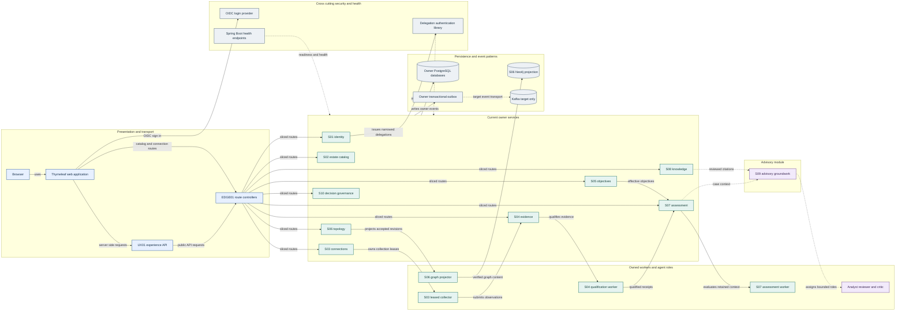
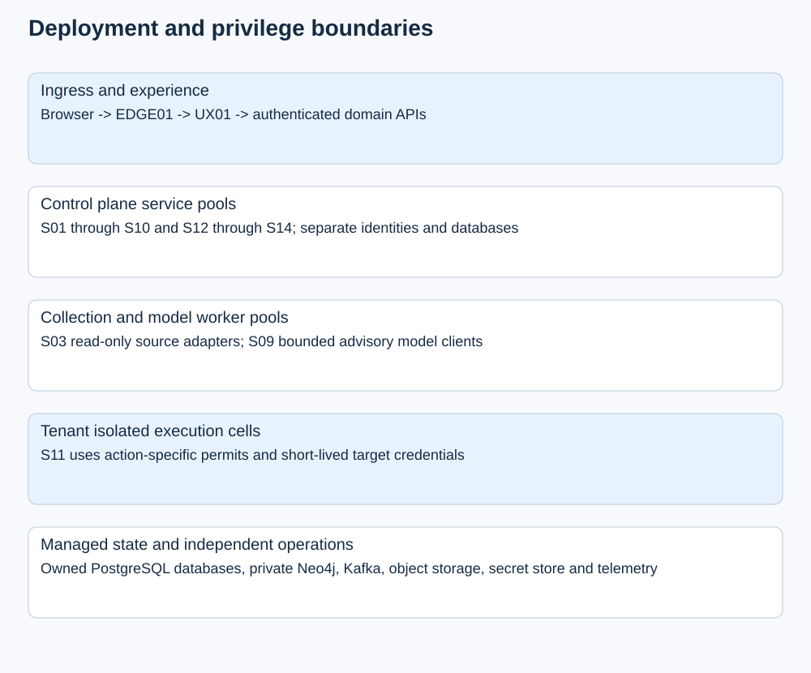

# UACRF architecture overview

The Unified Adaptive Cloud Resilience Framework (UACRF) is designed as a set
of independently deployable Java Spring Boot services. A browser application
reaches those services through an API edge and a unified experience API. The
experience API presents task-oriented workflows without making the browser a
privileged cloud client.

For service routes and communication contracts, see
[API and service communication contracts](api-service-contracts.md).

## Core design

The architecture defines fourteen domain services, an experience API, and an
API edge. Each domain service owns its business records, database credentials,
migrations, and API or event contracts. Services do not share tables or rely
on cross-domain database foreign keys.

PostgreSQL is the transactional authority for domain records. The topology
service owns Neo4j as a graph projection; accepted graph material remains
authoritative in PostgreSQL. A graph projection is eligible for decision use
only after its content and revision have been verified.

Services exchange authenticated HTTP requests when they need a current answer.
They use durable events for work that can be processed asynchronously. The
design expects duplicate delivery and uses owner-local outbox and inbox
processing rather than claiming exactly-once effects.

Provider collection, model invocation, and privileged execution use isolated
workers and explicit contracts. Collection credentials do not authorize
recovery actions, and advisory-agent output does not grant operational
authority.

## Product boundaries

- **Services and agents** are separately managed protected workloads. An agent
  can be registered independently or associated with a customer journey.
- **Customer journeys** describe outcomes and ordered steps. They link
  workloads and shared resources to customer goals; they do not replace
  workload inventories or define telemetry targets.
- **Shared resources** such as models, tools, knowledge, memory, runtimes, and
  identities can support services, agents, or both.
- **UACRF advisory agents** assist with evidence and recommendations. They are
  distinct from protected customer agents and do not authorize actions.
- **Recovery execution** requires current authorization, a bounded action,
  retained execution evidence, and independent validation. A provider's
  success response alone does not establish recovery.

## Reliability and migration principles

The design uses owner-local durable workflows, current authorization checks,
idempotent command handling, and explicit handling for uncertain provider
outcomes. If a provider may have accepted an action but its response is lost,
the outcome remains unknown until reconciled; the system must not blindly
repeat the mutation.

Migration proceeds one domain at a time. Each cutover has one authoritative
writer, a reconciled data and event watermark, and an ownership epoch.
Routing a request back to an older service is not sufficient to reverse writes
accepted by a new service.

## Status

The target design is not an implemented production architecture. The
[implementation status](IMPLEMENTATION_STATUS.md) tracks delivered slices and
remaining acceptance work. The service boundaries, contracts, diagrams, and
planned acceptance tests are documented in the
[MS01 architecture package](../design/ms01/README.md).

This two-layer map connects repository-backed UACRF services to the broader
cloud, agent, and infrastructure ecosystem in the MS01 target. Solid arrows
show implemented or local paths; dotted arrows show target, incomplete, or
unaccepted paths. Colors group component roles, not acceptance status. The
[implementation status](IMPLEMENTATION_STATUS.md) is authoritative for delivery
and acceptance claims.

## Application Architecture

```mermaid
flowchart TD
    subgraph People1["People and protected workloads"]
        Operator1["Operators owners and reviewers"]
        Browser1["Browser"]
        CustomerServices1["Customer cloud and platform services"]
        ProtectedAgents1["Protected customer agent runtimes"]
        SharedAgentResources1["Models tools memory identity runtime"]
    end
    subgraph Access1["Browser access and API entry"]
        Web1["Thymeleaf web application"]
        Ux1["UX01 experience API"]
        Edge1["EDGE01 API edge"]
    end
    subgraph CurrentOwners1["Current owner service modules"]
        S01["S01 identity and access slice"]
        S02["S02 estate catalog slice"]
        S03["S03 connections and ingestion slice"]
        S04["S04 evidence and qualification slice"]
        S05["S05 objectives and imports slice"]
        S06["S06 topology and graph slice"]
        S07["S07 assessment and learning slice"]
        S08["S08 knowledge and retrieval slice"]
        S10["S10 decision governance slice"]
    end
    subgraph AdvisoryOwner1["Advisory agent module"]
        S09["S09 advisory agent groundwork"]
    end
    subgraph FutureOwners1["MS01 target owners"]
        S11["S11 execution control planned"]
        S12["S12 recovery assurance planned"]
        S13["S13 commercial billing planned"]
        S14["S14 audit and notifications planned"]
    end
    subgraph Agents1["UACRF advisory agents"]
        AdvisoryRoles1["Analyst reviewer and critic roles"]
        ModelEndpoint1["Approved model endpoint"]
    end
    subgraph Cloud1["Cloud provider and telemetry endpoints"]
        AWS1["AWS inventory and metrics not accepted"]
        Azure1["Azure inventory and metrics not accepted"]
        Gcp1["GCP inventory and metrics not accepted"]
        KubernetesApi1["Kubernetes API source planned"]
        OTel1["OpenTelemetry sources planned"]
        PaymentApi1["Payment provider integration planned"]
    end
    subgraph Platform1["Runtime and state infrastructure"]
        Postgres1[("Separate owner PostgreSQL databases")]
        Neo4j1[("Neo4j S06 graph projection")]
        Kafka1[("Kafka target event platform")]
        ObjectStore1[("Object storage target artifact store")]
        Oidc1["Local Keycloak or external OIDC"]
        KubeRuntime1["Kubernetes production target"]
        ExecCell1["Isolated execution cell planned"]
        Telemetry1["Micrometer and OpenTelemetry target"]
        DelegationLib1["Delegation authentication library"]
    end
    Operator1 -->|"uses"| Browser1
    Browser1 -->|"loads protected pages"| Web1
    Web1 -->|"identity and context requests"| Ux1
    Web1 -->|"catalog and connection routes"| Edge1
    Ux1 -->|"public identity routes"| Edge1
    Browser1 -->|"OIDC sign in"| Oidc1
    Edge1 -->|"sliced owner routes"| CurrentOwners1
    S01 -->|"issues narrowed delegations"| DelegationLib1
    DelegationLib1 -.->|"validates internal calls"| CurrentOwners1
    CurrentOwners1 -->|"owner local transactions"| Postgres1
    FutureOwners1 -.->|"future owner local databases"| Postgres1
    S06 -->|"verified projection"| Neo4j1
    S03 -.->|"read only inventory and metrics"| AWS1
    S03 -.->|"read only inventory and metrics"| Azure1
    S03 -.->|"read only inventory and metrics"| Gcp1
    S03 -.->|"future workload inventory"| KubernetesApi1
    S03 -.->|"source observations"| OTel1
    CustomerServices1 -.->|"emits telemetry"| OTel1
    S03 -->|"normalized observations"| S04
    S04 -->|"qualified evidence receipts"| S07
    S05 -->|"effective objectives"| S07
    S06 -->|"accepted graph context"| S07
    S06 -->|"bounded objective receipt"| S05
    S07 -.->|"case context"| S09
    S08 -.->|"reviewed citations"| S09
    S09 -.->|"bounded role assignments"| AdvisoryRoles1
    AdvisoryRoles1 -.->|"advisory inference only"| ModelEndpoint1
    S09 -.->|"non executable recommendations"| Operator1
    S10 -.->|"permit and current fences"| S11
    S11 -.->|"bounded authorized plan"| ExecCell1
    ExecCell1 -.->|"scoped provider actions"| AWS1
    ExecCell1 -.->|"scoped provider actions"| Azure1
    ExecCell1 -.->|"scoped provider actions"| Gcp1
    S11 -.->|"controls protected runtimes"| ProtectedAgents1
    S12 -.->|"independent recovery probes"| CustomerServices1
    S12 -.->|"agent recovery validation"| ProtectedAgents1
    ProtectedAgents1 -->|"uses governed dependencies"| SharedAgentResources1
    S02 -->|"registers workloads and profiles"| ProtectedAgents1
    CurrentOwners1 -.->|"owner outbox events"| Kafka1
    FutureOwners1 -.->|"future owner events"| Kafka1
    Kafka1 -.->|"audit projections"| S14
    S14 -.->|"sealed exports"| ObjectStore1
    S13 -.->|"payment reconciliation"| PaymentApi1
    KubeRuntime1 -.->|"hosts isolated service pools"| CurrentOwners1
    KubeRuntime1 -.->|"hosts target owner pools"| FutureOwners1
    KubeRuntime1 -.->|"separates execution pool"| ExecCell1
    Telemetry1 -.->|"service health and traces"| CurrentOwners1
    classDef access fill:#e7f0ff,stroke:#345f9c,color:#102a43,stroke-width:1.5px;
    classDef owner fill:#e6f4f1,stroke:#237568,color:#123d36,stroke-width:1.5px;
    classDef advisory fill:#f2eafb,stroke:#7952a5,color:#36214e,stroke-width:1.5px;
    classDef external fill:#fff1df,stroke:#a56620,color:#4b2d0c,stroke-width:1.5px;
    classDef platform fill:#edf1f5,stroke:#52677b,color:#172b3b,stroke-width:1.5px;
    class Operator1,Browser1,Web1,Ux1,Edge1 access;
    class S01,S02,S03,S04,S05,S06,S07,S08,S10 owner;
    class S09,AdvisoryRoles1,ModelEndpoint1 advisory;
    class CustomerServices1,ProtectedAgents1,SharedAgentResources1,AWS1,Azure1,Gcp1,KubernetesApi1,OTel1,PaymentApi1 external;
    class S11,S12,S13,S14,Postgres1,Neo4j1,Kafka1,ObjectStore1,Oidc1,KubeRuntime1,ExecCell1,Telemetry1,DelegationLib1 platform;
```

<!-- mermaid-checked: no \n, no em-dash/en-dash, no {} in labels, subgraphs are id["label"], arrows are -->|"label"|, all subgraphs closed by end, ids unique -->

### Technology Stack Summary

| Layer | Technology | Version | Purpose |
|---|---|---|---|
| Application services | Java and Spring Boot | Java 25, Spring Boot 4.1.2 | Independently built API and owner-service modules |
| HTTP and security | Spring MVC, Spring Security, OAuth2 client | Managed by the Spring Boot parent | Service APIs, browser login, and protected routes |
| Browser | Thymeleaf | Managed by the Spring Boot parent | Server-rendered operator experience |
| Owner state | PostgreSQL | Digest-pinned local image; server version not declared here | Separate transactional database and runtime role per owner |
| Graph projection | Neo4j Community | 5.26.0 in local Compose | S06-only verified graph projection |
| Local identity | OIDC and Keycloak | Keycloak 26.8.2 in local Compose | Development identity provider; S01 remains permission authority |
| Provider collection | AWS Config, STS and CloudWatch; Azure Resource Graph and Monitor; GCP Asset Inventory and Monitoring | Provider-specific; conformance varies | S03 read-only source integrations, not interchangeable capability claims |
| Events and artifacts | Transactional outbox; Kafka and object storage in target design | Target components not deployed by current Compose | Durable cross-owner events and large immutable artifacts |
| Runtime | OCI images and Docker Compose; Kubernetes in target design | Kubernetes version not selected | Local infrastructure and future isolated production service pools |
| Advisory agents | S09 analyst, reviewer, and critic roles | Provider-disabled or incomplete path | Bounded recommendations only; no direct provider authority |

### Data Storage & External Services

Current local infrastructure provides owner-specific PostgreSQL instances,
Neo4j for the S06 projection, and Keycloak for development OIDC. Kafka,
production object storage, and Kubernetes are target architecture components,
not evidence of a deployed runtime. S03 has bounded read-only implementations
for AWS Config and CloudWatch, Azure Resource Graph and Monitor, and Google
Cloud Asset Inventory and Monitoring. These are partial capabilities, and all
three providers remain UNACCEPTED pending live read-only conformance. Kubernetes
and OpenTelemetry source integrations remain target work. Provider credentials
and actions are separate: S03 is read-only collection, while S11 and isolated
execution cells are planned for individually authorized mutations. Synthetic
sample observations do not establish provider conformance.

### Key Architectural Decisions

- Each domain owner controls its PostgreSQL records and authorization decisions; S06 alone writes its Neo4j projection.
- UACRF advisory agents are separate from protected customer agents. S09 recommendations remain non-executable; S10 authorization and S11 execution are distinct boundaries.
- Cloud integrations are qualified independently by provider and capability. A connector, UI icon, or target component does not establish live conformance.

## Component Relationships

<!-- mermaid-checked: no \n, no em-dash/en-dash, no {} in labels, subgraphs are id["label"], arrows are -->|"label"|, all subgraphs closed by end, ids unique -->

### Component Inventory

| Component | Layer | Type | Responsibility |
|---|---|---|---|
| Browser and Thymeleaf application | Presentation | Spring MVC and Thymeleaf | Human sign-in, identity pages through UX01, and catalog and connection routes through EDGE01 |
| UX01 experience API | Presentation | Spring Boot API | Server-side identity composition and fixed downstream calls |
| EDGE01 API edge | Presentation | Spring Boot route controllers | Public routing to implemented owner slices |
| S01 Identity and access | Business logic | Spring Boot owner service | Principals, memberships, scoped grants, and delegations |
| S02 Estate catalog | Business logic | Spring Boot owner service | Services, workloads, journeys, and agent profiles |
| S03 Connections and ingestion | Business logic | Spring Boot owner service | Connections, source bindings, leases, and observation intake |
| S04 Evidence and qualification | Business logic | Spring Boot owner service | Evidence retention, qualification, and owner receipts |
| S05 Objectives and imports | Business logic | Spring Boot owner service | Objective revisions, approvals, and active objective reads |
| S06 Topology and dependencies | Business logic | Spring Boot owner service | Accepted graph revisions, scoped queries, and reconciliation |
| S07 Assessment and learning | Business logic | Spring Boot owner service | Cases, deterministic evaluations, and recommendations |
| S08 Knowledge and retrieval | Business logic | Spring Boot owner service | Reviewed knowledge sources and purpose-bound retrieval |
| S09 Advisory orchestration | Business logic | Partial module and library | Advisory role groundwork; connected run admission and dispatch remain open |
| S10 Decision governance | Business logic | Partial Spring Boot owner service | Policy proposal, review, and read; operational authorization remains open |
| S03 collector | Worker | Leased provider worker | Bounded read-only inventory and metric collection; all providers remain unaccepted |
| S04 qualification worker | Worker | Owner worker | Apply retained schema and qualification policy to evidence |
| S06 graph projector | Worker | Lease-based projection worker | Project accepted revisions and verify Neo4j content |
| S07 assessment worker | Worker | Owner worker | Evaluate fixed cases against retained owner context |
| S09 advisory roles | Agent layer | Analyst, reviewer, and critic | Produce bounded advisory outputs; no operational authority |
| S11 execution and workload control | Target only | Planned owner service and isolated workers | Execute only current, bounded, authorized provider plans |
| S12 recovery assurance | Target only | Planned validation service | Run independent recovery probes and certify declared paths |
| S13 commercial and billing | Target only | Planned owner service | Govern pilots, usage, invoices, and reconciliation |
| S14 audit and notifications | Target only | Planned reporting service | Build attributable activity projections, exports, and delivery history |
| Owner PostgreSQL databases | Data access | Separate owner databases | Transactional authority, migrations, and local outbox records |
| S06 Neo4j projection | Data access | Graph database | Verified read projection; no other service writes it |
| Transactional outbox | Infrastructure | Owner-local persistence pattern | Publish durable events without cross-owner transactions |
| Kafka and object storage | Target only | Planned platform services | Event transport and immutable large-artifact retention |
| Delegation authentication | Cross cutting | Shared Java security library | Validate audience-, resource-, and purpose-scoped service credentials |
| OIDC and Keycloak | Cross cutting | Identity provider | Local development sign-in; production identity provider is deployment-specific |
| Kubernetes and execution cells | Target only | Runtime and network isolation | Separate ingress, control, collection, and privileged execution pools |

The target architecture and service ownership boundaries are documented in
[ARCHITECTURE.md](../design/ms01/ARCHITECTURE.md) and
[DEPLOYMENT_AND_OPERATIONS.md](../design/ms01/DEPLOYMENT_AND_OPERATIONS.md).
The diagram distinguishes those target components from the currently
implemented service slices; it does not mark any provider or full-system
workflow as accepted.

## Additional target diagrams

The system-context diagram shows the browser, API edge, experience API,
domain services, and supporting infrastructure:

The deployment diagram shows the planned deployment and privilege boundaries:

The [MS01 diagram index](../design/ms01/README.md#diagram-index) links
activity, sequence, conceptual class, infrastructure, and deployment views,
with editable sources. These depict the target architecture, not proof that
the pictured capabilities are deployed.
