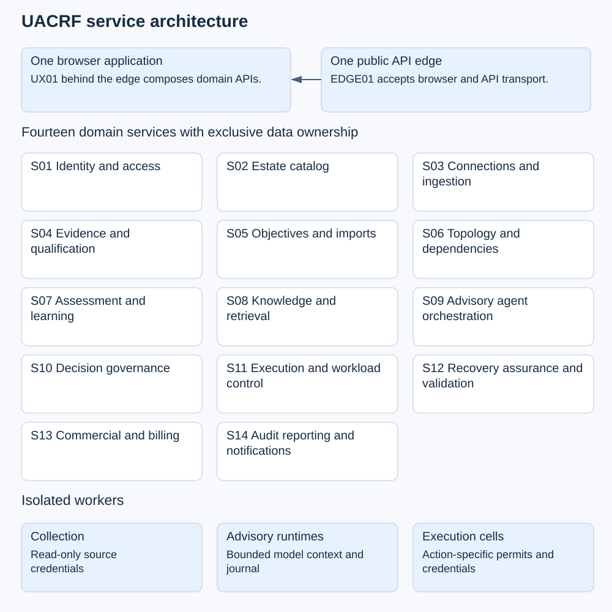
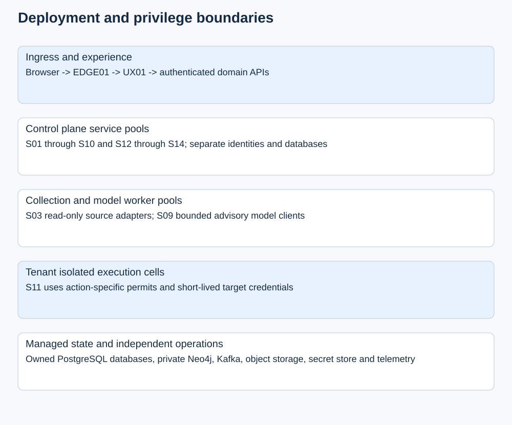

# UACRF architecture overview

The Unified Adaptive Cloud Resilience Framework (UACRF) is designed as a set
of independently deployable Java Spring Boot services. A browser application
reaches those services through an API edge and a unified experience API. The
experience API presents task-oriented workflows without making the browser a
privileged cloud client.

## Core design

The architecture defines fourteen domain services, an experience API, and an
API edge. Each domain service owns its business records, database credentials,
migrations, and API or event contracts. Services do not share tables or rely
on cross-domain database foreign keys.

PostgreSQL is the transactional authority for domain records. The topology
service owns Neo4j as a graph projection; accepted graph material remains
authoritative in PostgreSQL. A graph projection is eligible for decision use
only after its content and revision have been verified.

Services exchange authenticated HTTP requests when they need a current answer.
They use durable events for work that can be processed asynchronously. The
design expects duplicate delivery and uses owner-local outbox and inbox
processing rather than claiming exactly-once effects.

Provider collection, model invocation, and privileged execution use isolated
workers and explicit contracts. Collection credentials do not authorize
recovery actions, and advisory-agent output does not grant operational
authority.

## Diagrams

The system-context diagram shows the browser, API edge, experience API,
domain services, and supporting infrastructure:

The deployment diagram shows the planned deployment and privilege boundaries:

The [MS01 diagrams](ARCHITECTURE.md) provide
additional focused views of system context, event delivery, execution,
recovery validation, and migration.

## Product boundaries

- **Services and agents** are separately managed protected workloads. An agent
  can be registered independently or associated with a customer journey.
- **Customer journeys** describe outcomes and ordered steps. They link
  workloads and shared resources to customer goals; they do not replace
  workload inventories or define telemetry targets.
- **Shared resources** such as models, tools, knowledge, memory, runtimes, and
  identities can support services, agents, or both.
- **UACRF advisory agents** assist with evidence and recommendations. They are
  distinct from protected customer agents and do not authorize actions.
- **Recovery execution** requires current authorization, a bounded action,
  retained execution evidence, and independent validation. A provider's
  success response alone does not establish recovery.

## Reliability and migration principles

The design uses owner-local durable workflows, current authorization checks,
idempotent command handling, and explicit handling for uncertain provider
outcomes. If a provider may have accepted an action but its response is lost,
the outcome remains unknown until reconciled; the system must not blindly
repeat the mutation.

Migration proceeds one domain at a time. Each cutover has one authoritative
writer, a reconciled data and event watermark, and an ownership epoch.
Routing a request back to an older service is not sufficient to reverse writes
accepted by a new service.

## Status

This is the target design, not an implemented production architecture. The
service boundaries, contracts, diagrams, and planned acceptance tests are
documented in the [MS01 architecture package](../Microservices_Architecture/MS01/README.md).
Implementation starts with the [M0 and M1 milestones](../Microservices_Architecture/MS01/IMPLEMENTATION_PLAN.md).
