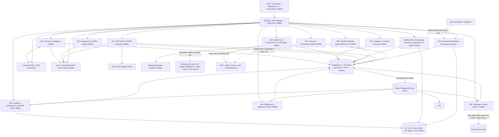
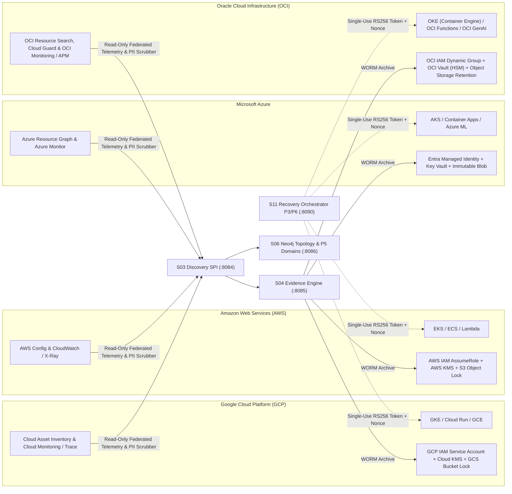
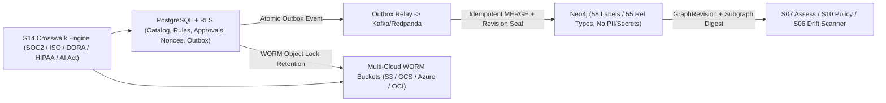

# UACRF System Architecture Overview (Multi-Cloud & Enterprise Compliance Rev 23)

## 1. Enterprise Logical Microservice & Polyglot Authority Architecture

## 2. How Cloud Provider Systems Integrate (`GCP`, `AWS`, `Azure`, `OCI`)

UACRF integrates cleanly across all four hyperscalers without vendor lock-in through strict **Read-Only Discovery SPI (`TelemetryAdapter`)**, **Bounded Action SPI (`ProviderActionAdapter`)**, **Cloud WORM Object Lock**, **Federated Workload Identity**, and **Cross-Cloud Correlation Domains (`P5`)**:

## 3. Polyglot Data & Compliance Authority Boundaries

## 4. Core Non-Overridable Invariants
1. **No Dual-Write**: Services commit business state and outbox records atomically in PostgreSQL; `S06` projects into Neo4j idempotently and verifies drift continuously.
2. **Fail-Closed by Default**: Missing, expired, provisional, drifted, or contradicted evidence yields `UNKNOWN`, `TAMPER_DETECTED`, or `DENY`.
3. **Separation of Duties**: No identity may propose and approve a high-risk action, approve own knowledge/impact profile, or conduct independent review on own assessment.
4. **Canonical Ontology & Data Minimization**: Every Neo4j node/edge must pass `Neo4jOntology` (`58` labels, `55` relationships) and prohibited-key checks (`secret`, `password`, `ssn`, `credit_card`, `raw_log_body`).
5. **Protected AI vs. Advisory Isolation**: Customer AI workloads require empirical quality/safety/fallback checks (`S04`); solution-specific advisors (`S09`) preserve blocking critic dissent and obey kill switches.

## 5. Enterprise Compliance & Traceability Extension
See [TECHNICAL_APPROACH_AND_COMPLIANCE_SPEC.md](TECHNICAL_APPROACH_AND_COMPLIANCE_SPEC.md), [ENTERPRISE_COMPLIANCE_AND_ROADMAP.md](../compliance/ENTERPRISE_COMPLIANCE_AND_ROADMAP.md), and [REQUIREMENTS_TRACEABILITY_MATRIX.md](../traceability/REQUIREMENTS_TRACEABILITY_MATRIX.md).
