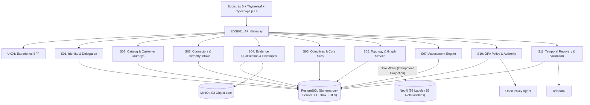
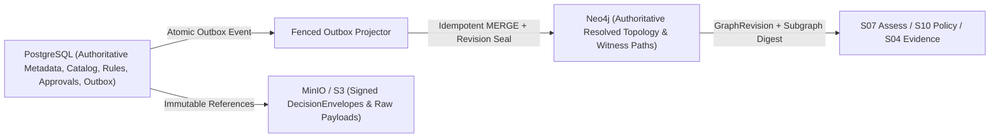

# UACRF System Architecture Overview (Milestone 0 Baseline)

## 1. Logical Microservice & Polyglot Authority Architecture

## 2. Polyglot Data Authority Boundary

## 3. Core Non-Overridable Invariants
1. **No Dual-Write**: Services commit business state and outbox records atomically in PostgreSQL; `S06` projects into Neo4j idempotently.
2. **Fail-Closed by Default**: Missing, expired, provisional, or contradicted evidence yields `UNKNOWN` or `DENY` for consequential operations.
3. **Separation of Duties**: No identity may propose and approve a high-risk action, nor qualify its own evidence.
4. **Canonical Ontology**: Every Neo4j node/edge must pass `Neo4jOntology` (58 node labels, 55 relationship types).

## 4. Enterprise Compliance & Traceability Extension
See [TECHNICAL_APPROACH_AND_COMPLIANCE_SPEC.md](TECHNICAL_APPROACH_AND_COMPLIANCE_SPEC.md), [ENTERPRISE_COMPLIANCE_AND_ROADMAP.md](../compliance/ENTERPRISE_COMPLIANCE_AND_ROADMAP.md), and [REQUIREMENTS_TRACEABILITY_MATRIX.md](../traceability/REQUIREMENTS_TRACEABILITY_MATRIX.md) for the expanded multi-standard Common Control Framework (**SOC 2, ISO 27001/22301/42001, GDPR, DORA, UK PRA, PCI DSS v4.0, HIPAA, FedRAMP/FIPS 140-3, EU AI Act, NIST AI RMF, SSDF**) and implementation tracking across `M0`–`M8` and `E1`–`E4`.
