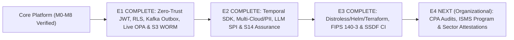

# Enterprise Production & Regulatory Compliance Progression (Phases E1–E4)

> UACRF builds upon its core microservice foundation (`M0`–`M8`) through three implemented technical hardening stages (`E1`–`E3`), culminating in organizational compliance certification (`E4`) across **SOC 2 Type I & Type II, ISO/IEC 27001/22301/42001, GDPR/ISO 27701, EU DORA, UK PRA/FCA, PCI DSS v4.0, HIPAA/HITECH, NIST AI RMF, EU AI Act, FedRAMP/FIPS 140-3, and NIST SSDF/SLSA**.

---

## Phase E1: Core Enterprise Security & Distributed Event Spine (`COMPLETE`)
Phase E1 hardens tenant boundaries, asynchronous event transport, and cryptographic evidence immutability:
- **E1.1 Identity Federation & Database Isolation:** `EdgeSecurityConfig` enforces OAuth2 Bearer JWT authentication along with Content Security Policy and clickjacking headers at `EDGE01`, while `TenantRlsSession` and `V2__enable_rls.sql` enforce PostgreSQL `FORCE ROW LEVEL SECURITY` across all twelve database-backed services.
- **E1.2 Asynchronous Outbox Relay:** `OutboxKafkaRelay` (`libs/uacrf-outbox`) reliably publishes transactional outbox events to Redpanda/Kafka partitions (`docker-compose.yml`), verified against live Kafka and PostgreSQL containers.
- **E1.3 Live OPA & WORM Object Lock:** `ObjectLockWormClient` writes immutable governance-locked evidence objects into S3-compatible WORM storage (`localstack/localstack:3.8` integration-verified), and `S10` executes policy decisions against live `openpolicyagent/opa:1.0.0`.
- **E1.4 Neo4j Schema Boot & Drift Scanner:** `docker-compose.yml` applies Neo4j constraints on startup, while `GraphDriftReconciler` (`S06`) detects topology divergence between PostgreSQL revisions and Neo4j state (`PROJECTED` vs. `DRIFTED`).

## Phase E2: Durable Workflows, Multi-Cloud/AI Adapters & `S14` Assurance (`COMPLETE`)
Phase E2 introduces durable orchestration, multi-cloud discovery and recovery adapters, privacy sanitization, and external assurance reporting:
- **E2.1 Temporal Durable Recovery Orchestrator (`S11`):** `RecoveryWorkflow` and `RecoveryActivities` (`io.temporal:temporal-sdk`) orchestrate bounded recovery actions, run the 8-layer P6 validation checks, and execute automatic saga compensation when mandatory checks fail (`TemporalRecoveryWorkflowTest`).
- **E2.2 Multi-Cloud Collectors & PII/PHI Redaction (`S03`, `S11`):** `AwsTelemetryAdapter`, `GcpTelemetryAdapter`, `AzureTelemetryAdapter`, `OciTelemetryAdapter`, and `OtelReceiverAdapter` implement the `TelemetryAdapter` SPI cleanly, while `PiiPhiScrubber` strips emails, SSNs, PCI PANs, and cloud/Bearer secrets before storage or outbox emission; `CloudTrafficFailoverAdapter` extends P3 bounded execution and compensation across all four clouds.
- **E2.3 Sandboxed Enterprise LLM Gateway (`S09`):** `EnterpriseLlmGateway` enforces SSRF metadata blocking, strips PII from outbound prompts, constrains outputs to non-authoritative summaries, and falls back deterministically while keeping blocking Critic dissent unresolved.
- **E2.4 Commercial Metering & External Assurance Rooms (`S14`):** `services/reporting-service` (port `8093`, database `uacrf_reporting` with RLS) records protected asset and evaluation metering, provides a live multi-framework compliance crosswalk, and issues time-bound, cryptographically watermarked auditor Assurance Rooms exposed via `EDGE01` and `UX01` (`/assurance`).

## Phase E3: Supply-Chain Integrity, Multi-Cloud IaC & Compliance Automation (`COMPLETE`)
Phase E3 packages the platform for hardened production operation and verifiable software supply-chain security:
- **E3.1 Containerization, Helm, Terraform & PITR Recovery:** Provides multi-stage non-root distroless packaging (`Dockerfile.service`), Kubernetes Helm templates (`infra/helm/uacrf/` with default-deny `NetworkPolicy`, Istio `STRICT` mTLS `PeerAuthentication`, non-root security contexts, and `PodDisruptionBudget`), multi-cloud KMS/WORM Terraform IaC (`infra/terraform/main.tf` covering AWS, GCP, Azure, and OCI), and point-in-time recovery scripting (`infra/scripts/backup-and-pitr.sh`).
- **E3.2 FIPS 140-3 Cryptography & KMS Provider Abstraction (`uacrf-crypto`):** `FipsCryptoProfile` and `VaultOrCloudKmsProvider` enforce minimum `3072`-bit RSA key strength under FIPS mode before signing authorizations or decision envelopes.
- **E3.3 NIST SSDF & SLSA CI Gates:** `.github/workflows/ci.yml` integrates Gitleaks secret scanning, Trivy vulnerability and IaC scanning, CodeQL Java SAST, CycloneDX SBOM generation, and Cosign signing readiness.
- **E3.4 Automated Technical Evidence Collection:** `infra/scripts/collect-soc2-evidence.sh` exports signed manifests combining Rego policies, Neo4j ontology catalogs, traceability state, commit metadata, and JUnit XML results.

## Phase E4: External Audits & Organizational Compliance Program (`NEXT`)
With all technical controls implemented in code and infrastructure definitions, organizational certification completes through independent attestation:
- **Corporate Governance & ISMS:** Formalize incident response plans (IRP), vendor risk assessments, personnel background screening, endpoint hardening, and internal audit reviews.
- **SOC 2 Type I & Type II / ISO 27001 / ISO 42001:** Complete CPA and accredited registrar assessments over sustained production operation, leveraging `S14` Assurance Rooms and automated evidence packs.
- **Sector-Specific Attestations:** Execute Business Associate Agreements (BAA) for HIPAA workloads, Qualified Security Assessor (QSA) scans where PCI Cardholder Data Environments apply, financial-entity ICT registers for EU DORA / UK PRA, and 3PAO/agency sponsorship for FedRAMP authorizations.
