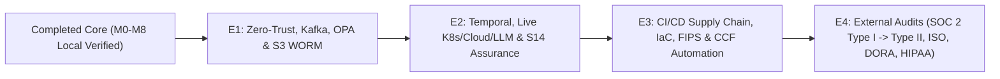

# Enterprise Production & Regulatory Certification Plan (Phases E1–E4)

> Builds on the completed **Local Core Platform (`M0`–`M8`, commits `50c1778..198c44d`)** to reach full enterprise production viability and multi-framework compliance (**SOC 2 Type II, ISO 27001/22301/42001, GDPR, DORA, UK PRA, PCI DSS, HIPAA, NIST AI RMF, EU AI Act, FedRAMP/FIPS, SSDF**).

---

## Phase E1: Core Enterprise Security & Distributed Spine (Est. 2–4 Days Engineering)
- **E1.1 Identity & DB Enforcement:** Wire Spring Security OIDC/JWT validation in `EDGE01` and `UX01` against Keycloak `uacrf-realm.json`; enable PostgreSQL Row-Level Security (`CREATE POLICY`) across all service schemas.
- **E1.2 Asynchronous Event Spine:** Add Redpanda/Kafka to `docker-compose.yml` and implement a leased outbox publisher worker in `uacrf-outbox` consuming `integration.outbox_event` into partitioned CloudEvents topics (`S03 -> S04 -> S06 -> S05 -> S10 -> S11 -> S12`).
- **E1.3 Live OPA & MinIO S3 Object Lock SDK:** Enable `uacrf.policy.opa.enabled=true` against signed Rego bundles; wire AWS S3 SDK (`PutObject` with Object Lock retention) in `S04` `EvidenceQualificationService` against MinIO/S3.
- **E1.4 Neo4j Reconciliation & Full Compose Run:** Add scheduled `PROJECTED` vs. `DRIFTED` checksum verification daemon in `S06` + load `01_constraints_and_indexes.cypher` automatically on boot; verify entire 17-container stack together + Playwright browser suite.

## Phase E2: Durable Workflows, Live Cloud/AI Adapters & `S14` Assurance (Est. 3–5 Days Engineering)
- **E2.1 Temporal Java SDK Integration (`S11`):** Register durable Temporal workflows/activities for the recovery state machine (`PROPOSED -> EXECUTING -> VALIDATING -> SUCCEEDED/COMPENSATED`) with heartbeat, retry, and observation-window timers.
- **E2.2 Live Multi-Cloud, K8s & OTel Adapters (`S03`, `S11`):** Implement `LiveK8sClusterAdapter` (tested via KinD), AWS/GCP/Azure/OCI read-only `TelemetryAdapter` beans (`AWS Config`, `GCP Asset Inventory`, `Azure Resource Graph`, `OCI Resource Search`), OTLP ingestion consumer, and mandatory PII/PHI scrubbing pipeline prior to raw payload archival.
- **E2.3 Sandboxed LLM Provider Integration (`S09`):** Connect `AdvisoryAgentService` to configurable enterprise model endpoints (Azure OpenAI / Vertex / Bedrock / OCI GenAI) with strict schema validation and SHA-256 citation grounding against `S08`.
- **E2.4 `S14` Commercial Metering & External Assurance Rooms (`reporting-service`):** Build `uacrf_reporting` service for protected asset metering, compliance crosswalk exports (**DORA / PRA / ISO 22301 / ISO 42001 / NIST AI RMF**), and watermarked time-bound auditor portals.

## Phase E3: Supply-Chain Integrity, Production IaC & Compliance Automation (Est. 2–4 Days Engineering)
- **E3.1 Containerization & IaC:** Author hardened distroless/multi-stage Dockerfiles for all microservices, Helm charts + Terraform modules (VPC isolation, mTLS service mesh, HPA/PDBs), and PITR backup/restore drill automation.
- **E3.2 FIPS 140-3 & Vault/KMS Key Management:** Externalize all signing keys (`S01`, `S07`, `S10`) to Vault Transit / Cloud KMS with automatic key rotation and an optional FIPS 140-3 crypto provider profile (`FedRAMP`).
- **E3.3 SSDF / SLSA CI Security Gates:** Expand `.github/workflows/ci.yml` with CycloneDX SBOM generation, Trivy vulnerability/CVE policy failure, Gitleaks secret scanning, CodeQL SAST, and Cosign container image signing.
- **E3.4 Automated SOC 2 & Multi-Standard Evidence Collectors:** Deploy CI/runtime collectors outputting timestamped proof for **CC1–CC9**, ISO 27001 Annex A, ISO 42001, HIPAA controls, and DORA registers.

## Phase E4: External Audits & Organizational Program (Organizational / CPA Calendar)
- **SOC 2 Type I + ISO 27001 Stage 1/2 Readiness:** Complete corporate policy suite (IRP, BCDR, Vendor Risk, HR background checks, MDM endpoint hardening) and pass Type I point-in-time audit (`~2–4 weeks` post-E3).
- **SOC 2 Type II Observation Window:** Run live production controls cleanly for `3–6 months` under independent CPA/platform continuous monitoring (e.g. Vanta/Drata + accredited CPA firm).
- **Sector Attestations:** Execute BAA & HITRUST/HIPAA readiness, PCI DSS SAQ/ROC segmentation scan (if CDE-scoped), ISO 42001 certification, and FedRAMP 3PAO Sponsor engagement (when pursuing US federal adoption).
