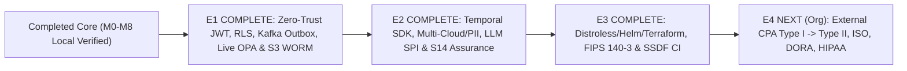

# Enterprise Production & Regulatory Certification Plan (Phases E1–E4)

> Builds on the **Local Core (`M0`–`M8`)** and **Enterprise Technical Phases (`E1`–`E3`)** to support multi-framework compliance (**SOC 2 Type II, ISO 27001/22301/42001, GDPR, DORA, UK PRA, PCI DSS, HIPAA, NIST AI RMF, EU AI Act, FedRAMP/FIPS, SSDF**).

---

## Phase E1: Core Enterprise Security & Distributed Spine (`COMPLETE`)
- **E1.1 Identity & DB Enforcement:** `EdgeSecurityConfig` OAuth2 Bearer JWT + CSP/frame headers (`EDGE01`), `TenantRlsSession`, and `V2__enable_rls.sql` (`FORCE ROW LEVEL SECURITY`) across all `12` DB-backed microservices.
- **E1.2 Asynchronous Event Spine:** Redpanda Kafka added to `docker-compose.yml` alongside `OutboxKafkaRelay` (`libs/uacrf-outbox`), verified against live Kafka & PostgreSQL containers.
- **E1.3 Live OPA & S3 Object Lock SDK:** `ObjectLockWormClient` wired into `S04` (`GOVERNANCE` retention mode, tested against LocalStack S3) and `PolicyServiceIntegrationTest` verified against live `openpolicyagent/opa:1.0.0`.
- **E1.4 Neo4j Reconciliation:** Added `neo4j-init` schema init in `docker-compose.yml` and `GraphDriftReconciler` (`PROJECTED` vs. `DRIFTED`) in `S06`.

## Phase E2: Durable Workflows, Multi-Cloud/AI Adapters & `S14` Assurance (`COMPLETE`)
- **E2.1 Temporal Java SDK Integration (`S11`):** Registered `RecoveryWorkflow` / `RecoveryActivities` (`io.temporal:temporal-sdk:1.27.0`), verified in `TemporalRecoveryWorkflowTest` for durable execution and automatic compensation on P6 probe failure.
- **E2.2 Multi-Cloud Collectors & PII/PHI Scrubber (`S03`, `S11`):** Implemented `AwsTelemetryAdapter`, `GcpTelemetryAdapter`, `AzureTelemetryAdapter`, `OciTelemetryAdapter`, `OtelReceiverAdapter`, `PiiPhiScrubber`, and `CloudTrafficFailoverAdapter`.
- **E2.3 Sandboxed LLM Provider SPI (`S09`):** Built `EnterpriseLlmGateway` enforcing SSRF metadata blocking, PII prompt redaction, and deterministic citation-grounded fallback.
- **E2.4 `S14` Commercial Metering & External Assurance Rooms (`services/reporting-service`):** Port `8093`, `uacrf_reporting` DB + RLS, asset metering, multi-framework regulatory crosswalk, time-bound watermarked auditor rooms, wired through `EDGE01` and `UX01` (`/assurance`).

## Phase E3: Supply-Chain Integrity, Production IaC & Compliance Automation (`COMPLETE`)
- **E3.1 Containerization & IaC:** Added multi-stage non-root `Dockerfile.service`, Helm chart (`infra/helm/uacrf/` with K8s `NetworkPolicy`, Istio `STRICT` mTLS `PeerAuthentication`, `PodDisruptionBudget`), multi-cloud Terraform composition (`infra/terraform/main.tf` for AWS/GCP/Azure/OCI), and `infra/scripts/backup-and-pitr.sh`.
- **E3.2 FIPS 140-3 & Vault/KMS Key Management:** Implemented `FipsCryptoProfile` + `VaultOrCloudKmsProvider` in `libs/uacrf-crypto` enforcing `RSA >= 3072` key strength under FIPS mode.
- **E3.3 SSDF / SLSA CI Security Gates:** Upgraded `.github/workflows/ci.yml` with Gitleaks, Trivy filesystem/IaC scan, CodeQL Java SAST, CycloneDX SBOM generation, and Cosign attestation readiness.
- **E3.4 Automated SOC 2 Evidence Collector:** Added `infra/scripts/collect-soc2-evidence.sh` exporting signed manifests of Rego policies, ontology contracts, traceability JSON, and JUnit XML results.

## Phase E4: External Audits & Organizational Program (`NEXT — Organizational / CPA Calendar`)
- **SOC 2 Type I + ISO 27001 Stage 1/2 Readiness:** Complete corporate policy suite (IRP, BCDR, Vendor Risk, HR background checks, MDM endpoint hardening) and pass Type I point-in-time audit.
- **SOC 2 Type II Observation Window:** Run live production controls cleanly for `3–6 months` under independent CPA observation.
- **Sector Attestations:** Execute BAA & HITRUST/HIPAA readiness, PCI DSS QSA/ASV scan on live CDE, ISO 42001 certification, and FedRAMP 3PAO sponsorship where pursued.
