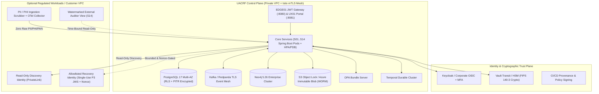

# UACRF Local & Enterprise Target Deployment Infrastructure

## 1. SSDF / SLSA DevSecOps Promotion & Supply-Chain Integrity Pipeline

```mermaid
flowchart LR
    Dev["Dev (SAMPLE_LOCAL Fixtures, Zero Prod Secrets)"] -->|PR + Review| CI["CI Build & Testcontainers (PG17 + Neo4j 5.26)"]
    CI --> Scan["SSDF Gates: CodeQL SAST + Gitleaks + Trivy CVE + CycloneDX SBOM"]
    Scan --> Sign["Cosign Image Signing + Digest Pinning"]
    Sign -->|Approved Change Ticket| Preprod["Preproduction Staging (Masked Data + S13 Fault Drills + Playwright E2E)"]
    Preprod -->|Dual-Approval Release Gate| Prod["Production Enterprise Cluster (RLS + KMS/FIPS + mTLS)"]
```

## 2. Zero-Trust Enterprise Network, Enclaves & Trust Boundaries

## 3. Compliance Controls Mapped to Infrastructure Layers
- **Network Segmentation & PCI CDE Isolation:** Standard telemetry runs in isolated VPCs; payment/CDE adapters deploy behind dedicated network policies and egress allowlists.
- **Data Residency & Erasure (GDPR / ISO 27701):** Regional Kubernetes deployments (`US`, `EU`) pin PostgreSQL, Neo4j, and S3 WORM buckets strictly in-region with tenant crypto-shredding keys managed in KMS.
- **Availability & Disaster Recovery (SOC 2 A1 / ISO 22301 / DORA):** Multi-AZ PostgreSQL with automated PITR backup/restore tests, Neo4j replication, Temporal crash recovery, and PodDisruptionBudgets (`PDB`).
