# UACRF Local & Multi-Cloud Enterprise Deployment Infrastructure (`GCP`, `AWS`, `Azure`, `OCI`)

## 1. SSDF / SLSA DevSecOps Promotion & Supply-Chain Integrity Pipeline

```mermaid
flowchart LR
    Dev["Dev (SAMPLE_LOCAL Fixtures, Zero Prod Secrets)"] -->|PR + Review| CI["CI Build & Testcontainers (PG17 + Neo4j 5.26)"]
    CI --> Scan["SSDF Gates: CodeQL SAST + Gitleaks + Trivy CVE + CycloneDX SBOM"]
    Scan --> Sign["Cosign Image Signing + Digest Pinning"]
    Sign -->|Approved Change Ticket| Preprod["Preproduction Staging (Masked Data + S13 Fault Drills + Playwright E2E)"]
    Preprod -->|Dual-Approval Release Gate| Prod["Production Enterprise Cluster (RLS + KMS/FIPS + mTLS)"]
```



## 2. Zero-Trust Four-Cloud Network, Identity & Infrastructure Topology

```mermaid
flowchart TB
    subgraph IdentityTrust["Identity & Cryptographic Trust Plane"]
        IDP["Keycloak / Corporate OIDC + MFA (OIDC Federation -> GCP / AWS / Azure / OCI)"]
        KMS["Vault Transit / Cloud HSM (AWS KMS, GCP KMS, Azure Key Vault, OCI Vault · FIPS 140-3)"]
        CIAM["CI/CD Provenance & OPA Policy Signing"]
    end

    subgraph ControlPlane["UACRF Control Plane (Private VPC / VCN + Istio mTLS Mesh)"]
        EDGE["EDGE01 JWT Gateway (:8080) & UX01 Portal (:8081)"]
        CoreSvc["Core Services (S01..S14 Spring Boot Pods + HPA/PDB)"]
        PG[("PostgreSQL 17 Multi-AZ (RLS + PITR Encrypted)")]
        KAFKA[("Kafka / Redpanda TLS Event Mesh")]
        NEO[("Neo4j 5.26 Enterprise Cluster")]
        WORM[("WORM Storage (S3 Object Lock / GCS Lock / Azure Immutable / OCI Retention)")]
        OPA["OPA Bundle Server"]
        TEMP["Temporal Durable Cluster"]
    end

    subgraph CloudGCP["GCP Production Boundary (Cloud Interconnect)"]
        GCP_RO["Read-Only Service Account (Asset Inventory + Monitoring)"]
        GCP_ACT["Scoped GKE / Cloud Run Rollback Identity (P3 Nonce)"]
    end

    subgraph CloudAWS["AWS Production Boundary (AWS PrivateLink)"]
        AWS_RO["Read-Only IAM Cross-Account Role (Config + CloudWatch)"]
        AWS_ACT["Scoped EKS / ECS Action Identity (P3 Nonce)"]
    end

    subgraph CloudAzure["Azure Production Boundary (ExpressRoute / Private Link)"]
        AZ_RO["Read-Only Entra Managed Identity (Resource Graph + Monitor)"]
        AZ_ACT["Scoped AKS / Container Apps Action Identity (P3 Nonce)"]
    end

    subgraph CloudOCI["OCI Production Boundary (FastConnect / Service Gateway)"]
        OCI_RO["Read-Only OCI Dynamic Group (Resource Search + Cloud Guard + APM)"]
        OCI_ACT["Scoped OKE / OCI Functions Action Identity (P3 Nonce)"]
    end

    EDGE --> CoreSvc
    CoreSvc <--> IDP
    CoreSvc --> KMS
    CoreSvc --> PG
    CoreSvc <--> KAFKA
    CoreSvc --> NEO
    CoreSvc --> WORM
    CoreSvc --> OPA
    CoreSvc --> TEMP

    CoreSvc -->|Read-Only PII-Scrubbed Ingestion| GCP_RO & AWS_RO & AZ_RO & OCI_RO
    CoreSvc -.->|Single-Use Signed P3 Execution| GCP_ACT & AWS_ACT & AZ_ACT & OCI_ACT
```



## 3. Compliance & Resilience Controls Mapped to Cloud Infrastructure
- **Separate Read-Only vs. Action Identities Across All 4 Clouds:** Discovery (`S03`) uses zero-write OIDC-federated identities (`GCP Service Account`, `AWS AssumeRole`, `Azure Managed Identity`, `OCI Dynamic Group`), while recovery (`S11`) assumes short-lived execution roles strictly gated by `P3` single-use RS256 JWS tokens and target allowlists.
- **Cross-Cloud Correlation-Domain Mapping (`P5`):** UACRF explicitly inspects whether multi-cloud paths (`AWS`, `GCP`, `Azure`, `OCI`) share underlying failure domains such as federated IdP, global DNS, shared KMS/Vault, or upstream third-party AI APIs.
- **Data Residency & Immutable Retention (`GDPR`, `HIPAA`, `DORA`):** Regional clusters pin PostgreSQL, Neo4j, and native cloud WORM buckets (**AWS S3 Object Lock**, **GCS Bucket Lock**, **Azure Immutable Blob**, **OCI Object Storage Retention Rules**) inside approved jurisdictions (`US`, `EU`).
- **PCI DSS v4.0 / FedRAMP Enclaves:** Cardholder Data Environments and FedRAMP workloads isolate telemetry collectors behind private interconnects (`PrivateLink`, `Cloud Interconnect`, `ExpressRoute`, `OCI Service Gateway`) with PII/PHI/PAN scrubbing prior to leaving the customer boundary.

## 4. Multi-Cloud Sandbox Connection & Onboarding Guide (`GCP`, `AWS`, `Azure`, `OCI`, `OTel`)

You do **not** need to install UACRF inside a cloud account to scan that account. Keep UACRF running locally (or in SaaS) and connect `S03` read-only (`NFR-SEC-003` — strictly separated from any `S11` recovery identity). Never commit cloud JSON keys or tokens to Git; store keys outside the repo (for example under `~/.config/`).

### Provider Live-Auth Readiness Matrix

| Provider | Live API Endpoint (`S03`) | Auth Implemented Today | Live Sandbox Status |
|---|---|---|---|
| **GCP** | `cloudasset.googleapis.com/v1` + `monitoring.googleapis.com/v3` + `logging.googleapis.com/v2` | Native `GcpCredentialProvider` (Service Account RS256 JWT + `authorized_user` ADC refresh + explicit bearer token) | **Verified live** (`uacrf-sandbox-123`: Asset Inventory + Cloud Monitoring + Cloud Audit Logs) |
| **Azure** | `management.azure.com/providers/Microsoft.ResourceGraph/resources` | Pre-minted short-lived Entra OAuth2 `bearer-token` (`UACRF_DISCOVERY_AZURE_TOKEN`) | Standby (`enabled=false`; Entra client-credential auto-refresh optional next step) |
| **AWS** | `resource-explorer-2.<region>.amazonaws.com/Search` | Bearer header / custom `endpoint-url` | Standby (`enabled=false`; native AWS SigV4 signer required before calling AWS directly without proxy) |
| **OCI** | `query.<region>.oci.oraclecloud.com/20180409/resources` | Bearer header / custom `endpoint-url` | Standby (`enabled=false`; native OCI HTTP Request Signing required before calling OCI directly without proxy) |
| **OTel** | `http://otel-collector:4318` | `OtelReceiverAdapter` + [otel-collector-config.yaml](../../infra/otel/otel-collector-config.yaml) | Local OTLP collector runs debug pipeline; HTTP forwarding into `/v1/telemetry/events` optional next step |

---

### 4.1 Google Cloud Platform (GCP) — GUI Console & CLI Setup (`Verified Live`)

#### Option A: Google Cloud Console Web GUI
1. **Create/Select Sandbox Project:** Open [Google Cloud Console](https://console.cloud.google.com/) and create or pick a sandbox project (note its **Project ID**, e.g. `uacrf-sandbox-123`).
2. **Enable Discovery APIs:** Go to **APIs & Services -> Library** and enable:
   - `Cloud Asset API` (`cloudasset.googleapis.com`)
   - `Cloud Monitoring API` (`monitoring.googleapis.com`)
   - `Cloud Logging API` (`logging.googleapis.com`)
   - `Cloud Resource Manager API` (`cloudresourcemanager.googleapis.com`)
3. **Create Read-Only Service Account (`uacrf-discovery-ro`):** Go to **IAM & Admin -> Service Accounts -> + Create Service Account** and grant only read-only roles:
   - `Cloud Asset Viewer` (`roles/cloudasset.viewer`)
   - `Monitoring Viewer` (`roles/monitoring.viewer`)
   - `Logs Viewer` (`roles/logging.viewer`) *(if adding later, open **IAM & Admin -> IAM**, edit `uacrf-discovery-ro`, click **+ Add Another Role -> Logs Viewer**, and wait ~30–60s for IAM propagation)*
   - `Browser` (`roles/browser`)
   *(Note: UACRF stores only compact change/error signals + `logging://` pointers from Cloud Audit Logs—never duplicating raw log archives.)*
4. **Download Sandbox JSON Key:** Open `uacrf-discovery-ro` -> **Keys -> Add Key -> Create new key -> JSON** and save outside the repo (e.g. `~/.config/gcloud/uacrf-gcp-sandbox.json`).
5. **Create Sample Resource(s):** In **Cloud Storage -> Buckets** or **Pub/Sub -> Topics**, create one tiny test resource so Cloud Asset Inventory returns real assets.

#### Option B: CLI / Docker `gcloud` or Terraform
- Automated script (uses host `gcloud` or Dockerized `google-cloud-cli`):
  ```bash
  docker run --rm -it -v "$HOME/.config/gcloud:/root/.config/gcloud" \
    gcr.io/google.com/cloudsdktool/google-cloud-cli:slim \
    gcloud auth application-default login
  ./infra/scripts/setup-gcp-sandbox.sh <YOUR_GCP_PROJECT_ID> --create-sample-bucket
  ```
- Or Terraform: [infra/terraform/gcp-sandbox-discovery/main.tf](../../infra/terraform/gcp-sandbox-discovery/main.tf)

#### Connect & Run UACRF `S03`
```bash
export UACRF_DISCOVERY_GCP_ENABLED=true
export UACRF_DISCOVERY_GCP_PROJECT=<YOUR_GCP_PROJECT_ID>
export GOOGLE_APPLICATION_CREDENTIALS="$HOME/.config/gcloud/uacrf-gcp-sandbox.json"
```
Trigger live scans via the portal (`/settings/connections` -> **Poll Live Cloud Inventory & Telemetry**) or directly via API:
- Asset Inventory (`POST /v1/inventory/poll`):
  ```json
  {"tenantId":"11111111-1111-7111-8111-111111111111","environmentId":"22222222-2222-7222-8222-222222222222","provider":"GCP","scopeFilter":"*"}
  ```
- Cloud Monitoring v3 + Cloud Logging v2 (`POST /v1/telemetry/poll/gcp`):
  ```json
  {"tenantId":"11111111-1111-7111-8111-111111111111","environmentId":"22222222-2222-7222-8222-222222222222","includeMetrics":true,"includeLogs":true,"windowMinutes":60,"persist":true}
  ```

---

### 4.2 Amazon Web Services (AWS) — GUI Console & CLI Setup

#### AWS Console GUI Steps
1. **Enable Resource Explorer:** Open **AWS Console -> AWS Resource Explorer** -> turn on Resource Explorer in your target region and create a default view/index.
2. **Enable AWS Config (Recommended for Change History):** Open **AWS Config -> Set up** for standard read-only configuration recording.
3. **Create Read-Only IAM Role (`uacrf-discovery-ro`):**
   - Go to **IAM -> Roles -> Create role** (Trusted entity: **Custom trust policy / OIDC / Account** for STS `AssumeRole` with `ExternalId`, separate from any execution role).
   - Attach only AWS managed read-only policies: `AWSConfigUserAccess`, `ResourceExplorerReadOnlyAccess`, and `CloudWatchReadOnlyAccess`.
4. **Optional Sample Sandbox Resource:** Create one tiny S3 bucket (`uacrf-sandbox-assets-...`) or SQS queue.

#### Environment Variables (`discovery-service`)
```bash
export UACRF_DISCOVERY_AWS_ENABLED=true
export UACRF_DISCOVERY_AWS_REGION=us-east-1
export UACRF_DISCOVERY_AWS_AUTH_MODE=IAM_ASSUME_ROLE
export UACRF_DISCOVERY_AWS_ROLE_ARN=arn:aws:iam::<ACCOUNT_ID>:role/uacrf-discovery-ro
# Note: Direct calls to AWS Resource Explorer require an AWS SigV4 signing proxy/adapter via UACRF_DISCOVERY_AWS_ENDPOINT until native SigV4 signing is added.
```

---

### 4.3 Microsoft Azure — GUI Portal Setup

#### Azure Portal GUI Steps
1. **Register Provider & Resource Group:** In **Azure Portal**, select your sandbox **Subscription** -> **Resource providers** -> verify `Microsoft.ResourceGraph` and `Microsoft.Insights` are registered; create or pick a resource group (e.g. `uacrf-sandbox-rg`).
2. **Create Read-Only App / Managed Identity:** Go to **Microsoft Entra ID -> App registrations -> New registration** (`uacrf-discovery-ro`) or use an AKS **Managed Identity**.
3. **Assign Read-Only RBAC Roles:** In your sandbox **Subscription -> Access control (IAM) -> + Add role assignment**, grant only:
   - `Reader`
   - `Monitoring Reader`
4. **Mint Short-Lived Bearer Token (CLI/OIDC) or Managed Identity Token:**
   ```bash
   az account get-access-token --resource https://management.azure.com/ --query accessToken -o tsv
   ```

#### Environment Variables (`discovery-service`)
```bash
export UACRF_DISCOVERY_AZURE_ENABLED=true
export UACRF_DISCOVERY_AZURE_SUB=<SUBSCRIPTION_ID>
export UACRF_DISCOVERY_AZURE_AUTH_MODE=MANAGED_IDENTITY
export UACRF_DISCOVERY_AZURE_TOKEN=<SHORT_LIVED_ENTRA_BEARER_TOKEN>
```

---

### 4.4 Oracle Cloud Infrastructure (OCI) — GUI Console Setup

#### OCI Console GUI Steps
1. **Pick Sandbox Compartment:** Open **OCI Console -> Identity & Security -> Compartments** and note your compartment/tenancy OCID.
2. **Create Read-Only Group / Dynamic Group (`uacrf-discovery-ro`):** Go to **Identity & Security -> Domains -> Groups** (or **Dynamic Groups** when running on OKE/OCI compute).
3. **Create Read-Only IAM Policy:** Go to **Identity & Security -> Policies -> Create Policy** inside the sandbox compartment:
   ```text
   Allow group uacrf-discovery-ro to inspect all-resources in compartment <sandbox-compartment>
   Allow group uacrf-discovery-ro to read metrics in compartment <sandbox-compartment>
   ```
4. **Optional Sample Resource:** Create one tiny Standard Object Storage bucket or Streaming stream in the sandbox compartment.

#### Environment Variables (`discovery-service`)
```bash
export UACRF_DISCOVERY_OCI_ENABLED=true
export UACRF_DISCOVERY_OCI_REGION=us-ashburn-1
export UACRF_DISCOVERY_OCI_TENANCY=<TENANCY_OCID>
export UACRF_DISCOVERY_OCI_AUTH_MODE=INSTANCE_PRINCIPAL
# Note: Direct calls to OCI Search Service require OCI HTTP Request Signing (or signing proxy via UACRF_DISCOVERY_OCI_ENDPOINT).
```

---

### 4.5 OpenTelemetry Collector (`OTEL`) — Local Collector Setup
1. Start the bundled collector from `docker-compose up -d otel-collector` (listens on OTLP gRPC `:4317` and HTTP `:4318` per [otel-collector-config.yaml](../../infra/otel/otel-collector-config.yaml)).
2. Point instrumented services at `OTEL_EXPORTER_OTLP_ENDPOINT=http://localhost:4318`.
3. `OtelReceiverAdapter` is enabled by default via `UACRF_DISCOVERY_OTEL_ENABLED=true` (`UACRF_DISCOVERY_OTEL_ENDPOINT=http://otel-collector:4318`); normalized runtime observations can also be pushed directly to `POST /v1/telemetry/events`.
