# UACRF Local & Multi-Cloud Enterprise Deployment Infrastructure (`GCP`, `AWS`, `Azure`, `OCI`)

## 1. SSDF / SLSA DevSecOps Promotion & Supply-Chain Integrity Pipeline

```mermaid
flowchart LR
    Dev["Dev (SAMPLE_LOCAL Fixtures, Zero Prod Secrets)"] -->|PR + Review| CI["CI Build & Testcontainers (PG17 + Neo4j 5.26)"]
    CI --> Scan["SSDF Gates: CodeQL SAST + Gitleaks + Trivy CVE + CycloneDX SBOM"]
    Scan --> Sign["Cosign Image Signing + Digest Pinning"]
    Sign -->|Approved Change Ticket| Preprod["Preproduction Staging (Masked Data + S13 Fault Drills + Playwright E2E)"]
    Preprod -->|Dual-Approval Release Gate| Prod["Production Enterprise Cluster (RLS + KMS/FIPS + mTLS)"]
```

## 2. Zero-Trust Four-Cloud Network, Identity & Infrastructure Topology

```mermaid
flowchart TB
    subgraph IdentityTrust["Identity & Cryptographic Trust Plane"]
        IDP["Keycloak / Corporate OIDC + MFA (OIDC Federation -> GCP / AWS / Azure / OCI)"]
        KMS["Vault Transit / Cloud HSM (AWS KMS, GCP KMS, Azure Key Vault, OCI Vault · FIPS 140-3)"]
        CIAM["CI/CD Provenance & OPA Policy Signing"]
    end

    subgraph ControlPlane["UACRF Control Plane (Private VPC / VCN + Istio mTLS Mesh)"]
        EDGE["EDGE01 JWT Gateway (:8080) & UX01 Portal (:8081)"]
        CoreSvc["Core Services (S01..S14 Spring Boot Pods + HPA/PDB)"]
        PG[("PostgreSQL 17 Multi-AZ (RLS + PITR Encrypted)")]
        KAFKA[("Kafka / Redpanda TLS Event Mesh")]
        NEO[("Neo4j 5.26 Enterprise Cluster")]
        WORM[("WORM Storage (S3 Object Lock / GCS Lock / Azure Immutable / OCI Retention)")]
        OPA["OPA Bundle Server"]
        TEMP["Temporal Durable Cluster"]
    end

    subgraph CloudGCP["GCP Production Boundary (Cloud Interconnect)"]
        GCP_RO["Read-Only Service Account (Asset Inventory + Monitoring)"]
        GCP_ACT["Scoped GKE / Cloud Run Rollback Identity (P3 Nonce)"]
    end

    subgraph CloudAWS["AWS Production Boundary (AWS PrivateLink)"]
        AWS_RO["Read-Only IAM Cross-Account Role (Config + CloudWatch)"]
        AWS_ACT["Scoped EKS / ECS Action Identity (P3 Nonce)"]
    end

    subgraph CloudAzure["Azure Production Boundary (ExpressRoute / Private Link)"]
        AZ_RO["Read-Only Entra Managed Identity (Resource Graph + Monitor)"]
        AZ_ACT["Scoped AKS / Container Apps Action Identity (P3 Nonce)"]
    end

    subgraph CloudOCI["OCI Production Boundary (FastConnect / Service Gateway)"]
        OCI_RO["Read-Only OCI Dynamic Group (Resource Search + Cloud Guard + APM)"]
        OCI_ACT["Scoped OKE / OCI Functions Action Identity (P3 Nonce)"]
    end

    EDGE --> CoreSvc
    CoreSvc <--> IDP
    CoreSvc --> KMS
    CoreSvc --> PG
    CoreSvc <--> KAFKA
    CoreSvc --> NEO
    CoreSvc --> WORM
    CoreSvc --> OPA
    CoreSvc --> TEMP

    CoreSvc -->|Read-Only PII-Scrubbed Ingestion| GCP_RO & AWS_RO & AZ_RO & OCI_RO
    CoreSvc -.->|Single-Use Signed P3 Execution| GCP_ACT & AWS_ACT & AZ_ACT & OCI_ACT
```

## 3. Compliance & Resilience Controls Mapped to Cloud Infrastructure
- **Separate Read-Only vs. Action Identities Across All 4 Clouds:** Discovery (`S03`) uses zero-write OIDC-federated identities (`GCP Service Account`, `AWS AssumeRole`, `Azure Managed Identity`, `OCI Dynamic Group`), while recovery (`S11`) assumes short-lived execution roles strictly gated by `P3` single-use RS256 JWS tokens and target allowlists.
- **Cross-Cloud Correlation-Domain Mapping (`P5`):** UACRF explicitly inspects whether multi-cloud paths (`AWS`, `GCP`, `Azure`, `OCI`) share underlying failure domains such as federated IdP, global DNS, shared KMS/Vault, or upstream third-party AI APIs.
- **Data Residency & Immutable Retention (`GDPR`, `HIPAA`, `DORA`):** Regional clusters pin PostgreSQL, Neo4j, and native cloud WORM buckets (**AWS S3 Object Lock**, **GCS Bucket Lock**, **Azure Immutable Blob**, **OCI Object Storage Retention Rules**) inside approved jurisdictions (`US`, `EU`).
- **PCI DSS v4.0 / FedRAMP Enclaves:** Cardholder Data Environments and FedRAMP workloads isolate telemetry collectors behind private interconnects (`PrivateLink`, `Cloud Interconnect`, `ExpressRoute`, `OCI Service Gateway`) with PII/PHI/PAN scrubbing prior to leaving the customer boundary.
