# UACRF Activity Diagrams (Decision Logic, Guardrails & Control Workflows)

> Activity diagrams detailing every deterministic gate, fail-closed branch, and closed-loop verification workflow implemented across `S01`–`S13`.

---

## AD-01: Unified UACRF Lifecycle Activity (`Assess -> Control -> Recover -> Evidence -> Learn`)

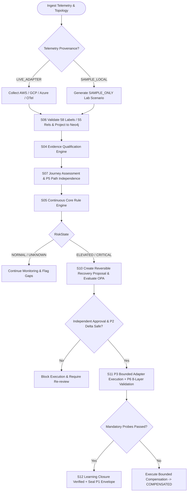

---

## AD-02: Deterministic Evidence Qualification & `No-Synthetic-Fallback` Activity (`S04`)

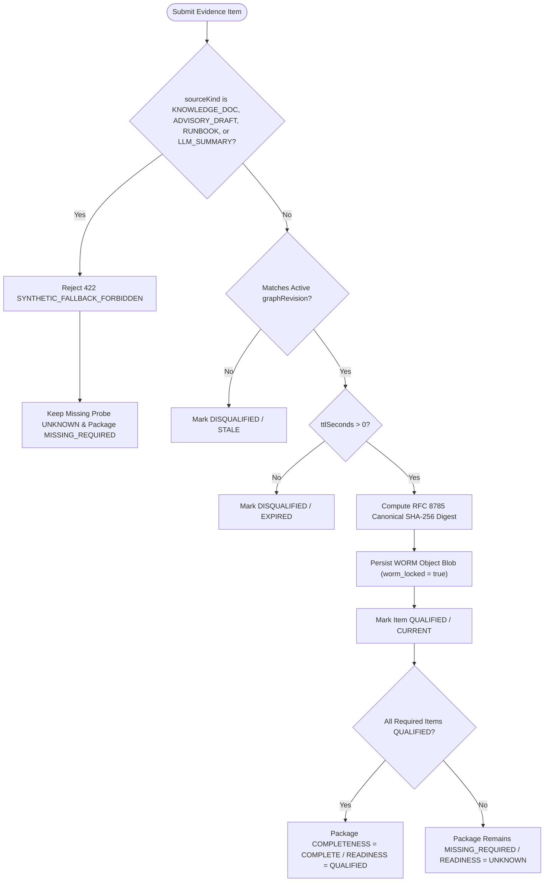

---

## AD-03: Neo4j 58-Label Ontology Validation & Dependency Inspection (`S06`)

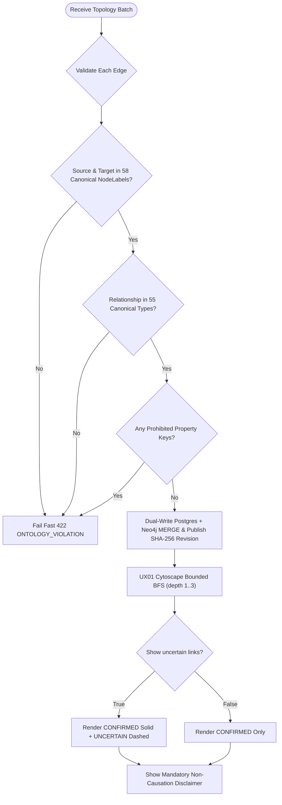

---

## AD-04: Correlation-Domain Path Certification (`P5`) & Report Issuance (`S07`)

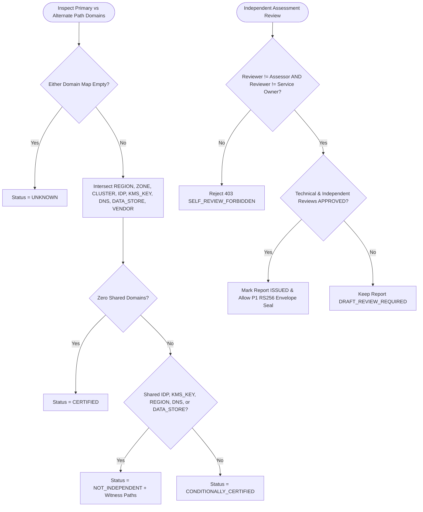

---

## AD-05: Continuous Core Control Rule Evaluation State Machine (`S05`)

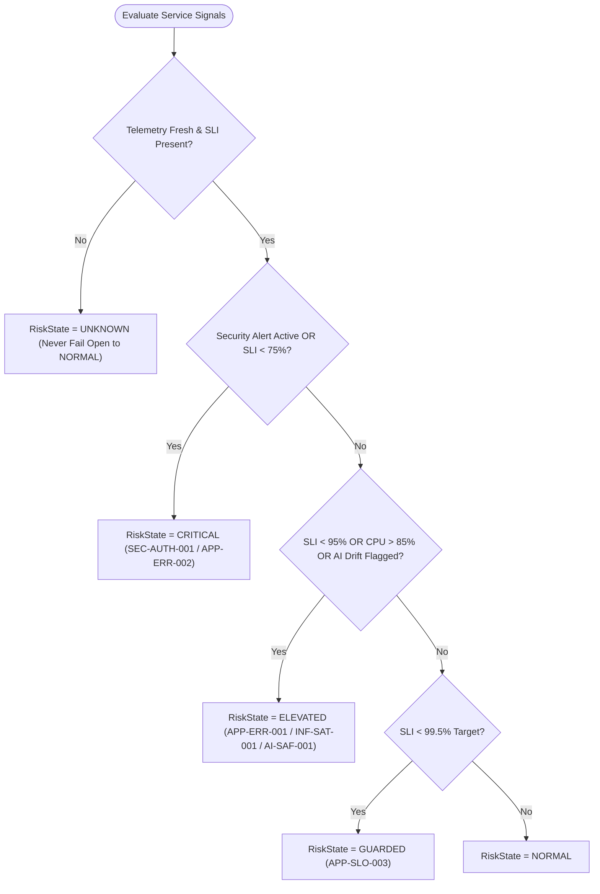

---

## AD-06: Pre-Execution `MaterialGraphDelta` (`P2`) & Bounded Recovery Activity (`S10`, `S11`)

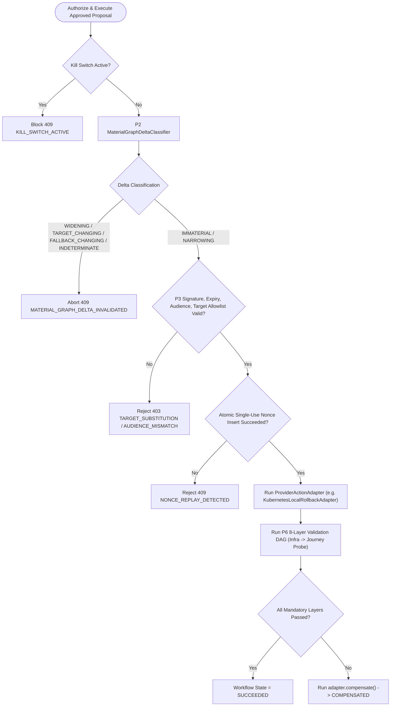

---

## AD-07: Controlled Experiment Guardrails & Learning Closure Activity (`S12`, `S13`)

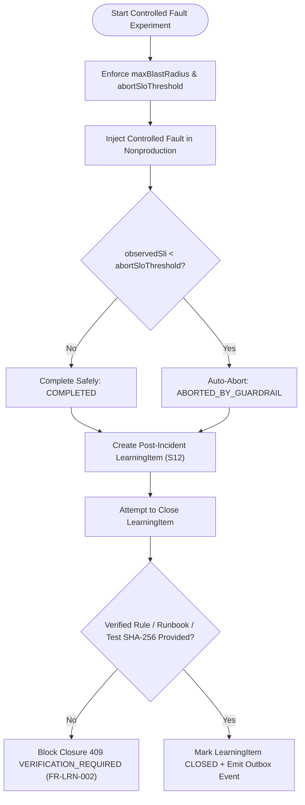

---

## AD-08: Solution-Specific Agent Advisors (`S09`) & Quantitative Shadow Isolation

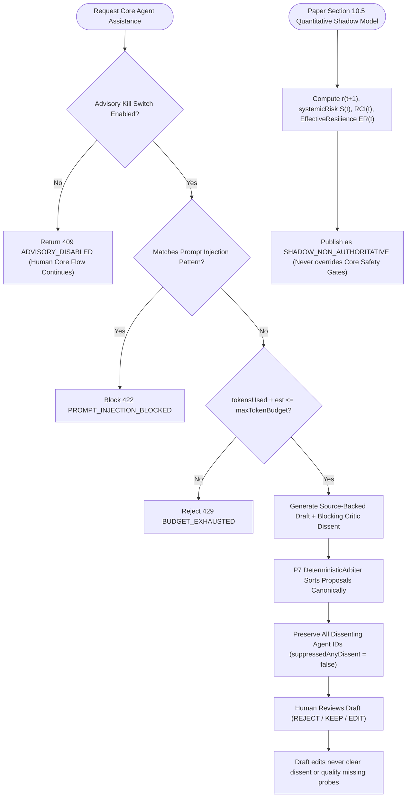

---

## Enterprise & Regulatory Compliance Activity Diagrams (`Phase E1–E4 Scope`)

## AD-09: PII/PHI/PAN Scrubbing, Data Residency Routing & WORM Retention (`REG-GDPR`, `REG-HIPAA`)

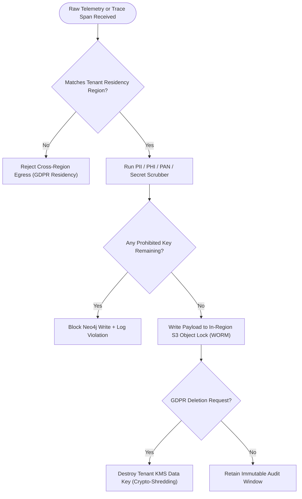

---

## AD-10: Scheduled Neo4j Anti-Tamper Drift Reconciliation Activity (`FR-GPH-007`)

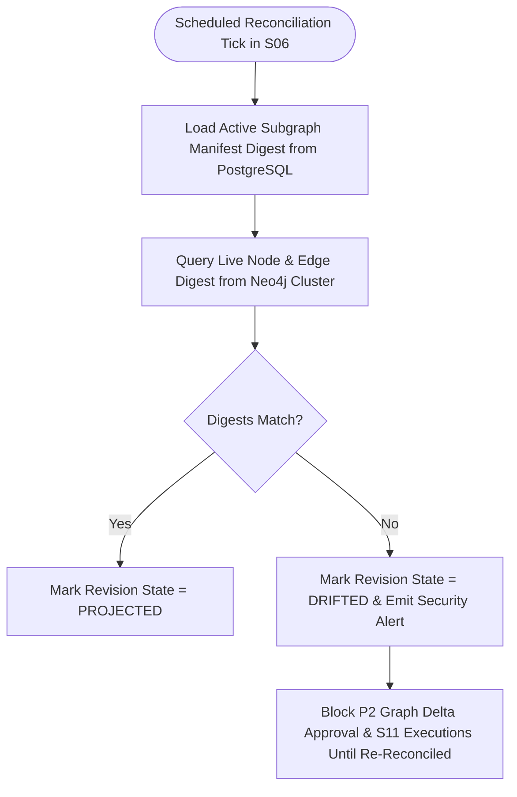

---

## AD-11: CI/CD Supply-Chain Security & SSDF / SLSA Gate Activity (`REG-SSDF`, `REG-FEDRAMP`)

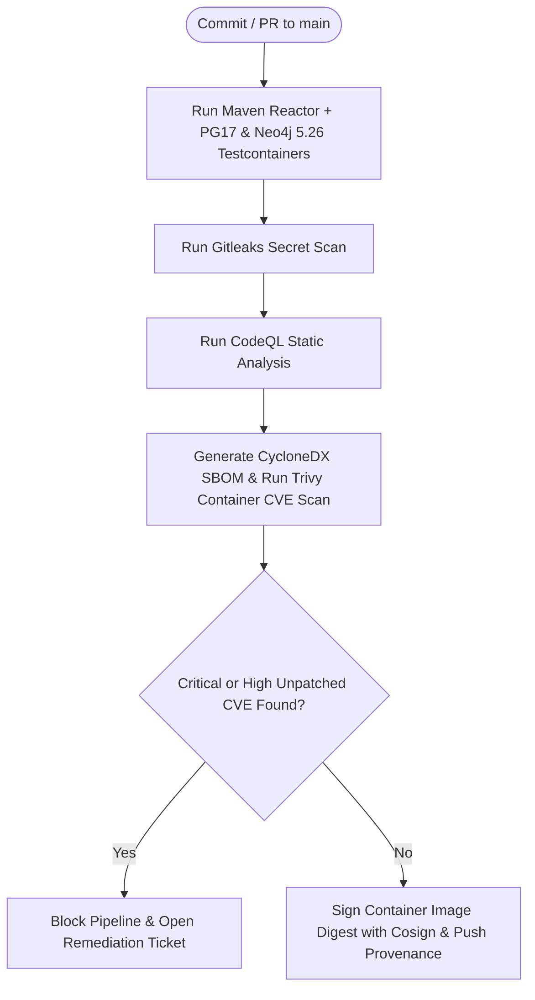

---

## AD-12: Multi-Framework Common Control Crosswalk & External Assurance Room Activity (`S14`)

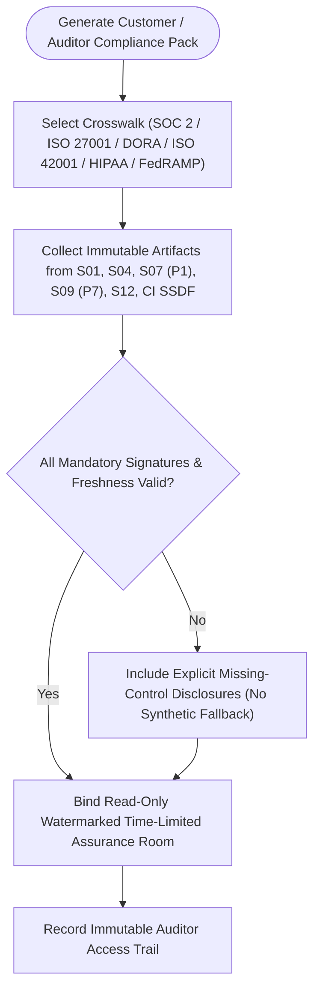
