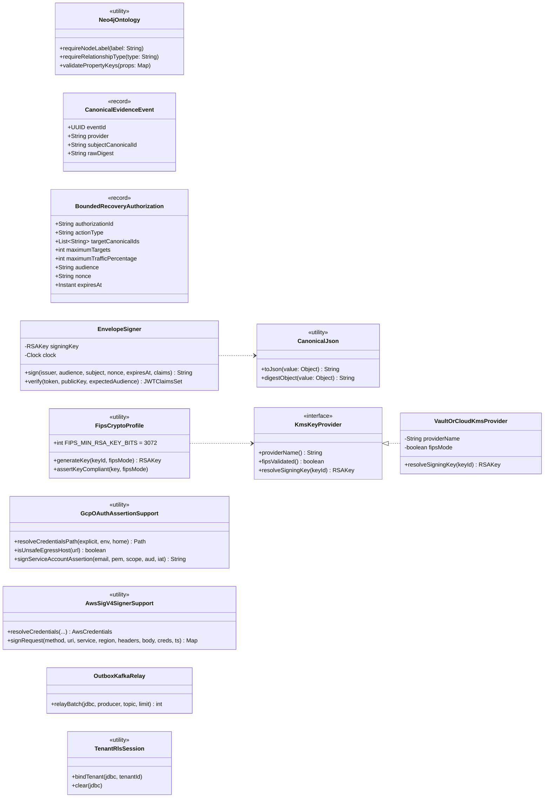
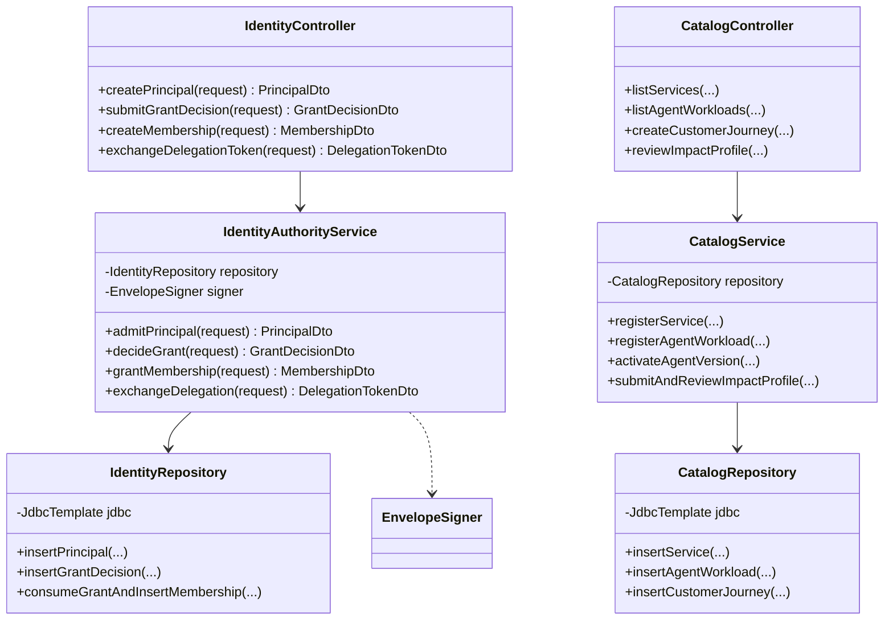
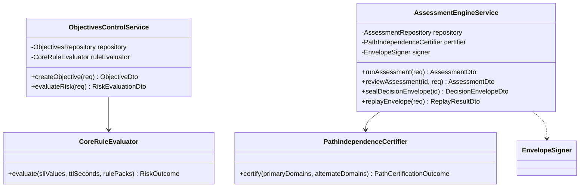
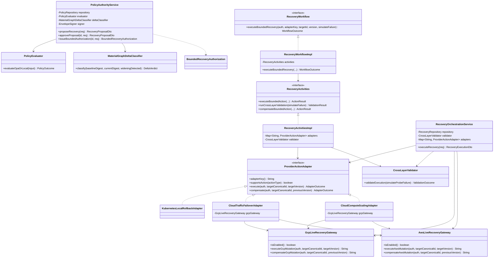
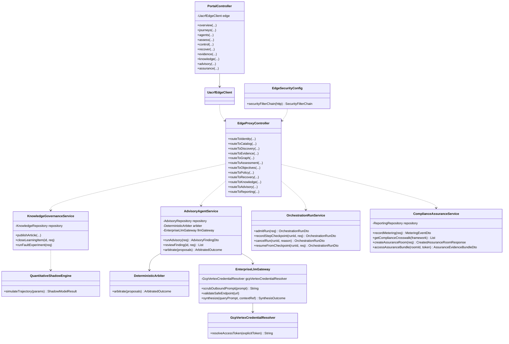

# UACRF Implemented Solution Class Diagrams (`CD-01`–`CD-06`)

> Class architecture diagrams derived directly from the verified Java 25 / Spring Boot 4.1.2 codebase across shared libraries (`uacrf-contracts`, `uacrf-crypto`, `uacrf-outbox`) and all implemented platform components (`S01`–`S14`, `EDGE01`, `UX01`).

---

## CD-01: Shared Contracts, FIPS Cryptographic Integrity & Transactional Outbox
*Shows the core contract records, ontology validator, canonical hashing, FIPS 140-3 key compliance checks, and Postgres-to-Kafka outbox helper shared across all services.*

---

## CD-02: Identity Authority & Catalog / Customer Journey Domain (`S01`, `S02`)
*Illustrates `S01` identity/delegation controllers and `S02` service, agent workload, customer journey, compute placement, and provider alias components.*

---

## CD-03: Multi-Cloud Discovery, PII Scrubbing, Evidence Qualification & Knowledge Graph (`S03`, `S04`, `S06`)
*Captures read-only multi-cloud collectors, pre-storage PII/PHI scrubbing, S3 Object Lock evidence qualification, and Neo4j projection with drift reconciliation.*

```mermaid
classDiagram
    class TelemetryAdapter {
        <<interface>>
        +providerKey() String
        +telemetrySource() String
        +collectSnapshot(tenantId, envId, scenarioKey) AdapterBatch
    }
    class SampleLocalScenarioGenerator {
        +collectSnapshot(...) AdapterBatch
    }
    class AwsTelemetryAdapter
    class GcpTelemetryAdapter
    class AzureTelemetryAdapter
    class OciTelemetryAdapter
    class OtelReceiverAdapter
    class PiiPhiScrubber {
        +scrubText(input) ScrubResult
        +scrubDimensions(dimensions) Map
    }
    class DiscoveryIngestionService {
        -DiscoveryRepository repository
        -PiiPhiScrubber scrubber
        -CloudInventoryPollerGateway inventoryGateway
        -GcpRuntimeTelemetryPoller gcpRuntimePoller
        -Map~String, TelemetryAdapter~ adapters
        +ingestObservation(req) ObservationDto
        +pollCloudInventory(req) InventoryNormalizationResult
        +pollGcpRuntimeTelemetry(req) RuntimeTelemetryPollResult
        +loadSampleLocalScenario(req) SampleScenarioResult
        +listRegisteredAdapters() List
    }
    class CloudInventoryPollerGateway {
        -AwsCredentialProvider awsCredentialProvider
        -GcpCredentialProvider gcpCredentialProvider
        +pollAndNormalize(provider, scopeFilter) InventoryNormalizationResult
    }
    class AwsCredentialProvider {
        +resolveSigV4Credentials() AwsCredentials
    }
    class AwsRuntimeTelemetryPoller {
        -AwsCredentialProvider credentialProvider
        +poll(req) AwsRuntimeTelemetryPollResult
    }
    class GcpCredentialProvider {
        +resolveAccessToken() String
    }
    class GcpRuntimeTelemetryPoller {
        -GcpCredentialProvider credentialProvider
        +pollRuntimeTelemetry(projectId, filter, windowMinutes) RuntimePollOutcome
    }
    class EvidenceQualificationService {
        -EvidenceRepository repository
        -QualificationEngine engine
        -ObjectLockWormClient s3WormClient
        +submitEvidence(pkgId, req) EvidencePackageDto
        +exportPackage(pkgId) ExportBundleDto
    }
    class QualificationEngine {
        +qualify(itemKey, sourceKind, detail, expectedRevision, ttl) QualificationVerdict
    }
    class ObjectLockWormClient {
        -S3Client s3Client
        +storeWormObject(key, payloadJson, sha256Digest) boolean
    }
    class KnowledgeGraphService {
        -GraphRepository repository
        -Neo4jGraphGateway neo4jGateway
        -GraphDriftReconciler driftReconciler
        +projectEdges(req) ProjectionResult
        +queryBoundedNeighborhood(req) SubgraphDto
    }
    class Neo4jGraphGateway {
        +mergeNodeAndEdge(...)
        +readTopology(...)
    }
    class GraphDriftReconciler {
        +reconcile(tenantId, envId) DriftReport
    }

    TelemetryAdapter <|.. SampleLocalScenarioGenerator
    TelemetryAdapter <|.. AwsTelemetryAdapter
    TelemetryAdapter <|.. GcpTelemetryAdapter
    TelemetryAdapter <|.. AzureTelemetryAdapter
    TelemetryAdapter <|.. OciTelemetryAdapter
    TelemetryAdapter <|.. OtelReceiverAdapter
    DiscoveryIngestionService --> TelemetryAdapter
    DiscoveryIngestionService --> PiiPhiScrubber
    DiscoveryIngestionService --> CloudInventoryPollerGateway
    DiscoveryIngestionService --> GcpRuntimeTelemetryPoller
    CloudInventoryPollerGateway --> GcpCredentialProvider
    GcpRuntimeTelemetryPoller --> GcpCredentialProvider
    GcpRuntimeTelemetryPoller --> PiiPhiScrubber
    EvidenceQualificationService --> QualificationEngine
    EvidenceQualificationService --> ObjectLockWormClient
    KnowledgeGraphService --> Neo4jGraphGateway
    KnowledgeGraphService --> GraphDriftReconciler
    KnowledgeGraphService ..> Neo4jOntology
```

---

## CD-04: Objectives Rules, Path Independence & Sealed Decision Envelopes (`S05`, `S07`, `P1`, `P5`)
*Depicts continuous SLO rule evaluation, upstream conflict checks, correlation-domain path certification, and RS256 decision sealing.*

---

## CD-05: Policy Authority, Temporal Recovery Orchestrator & P6 Validation (`S10`, `S11`, `P2`, `P3`, `P6`)
*Maps OPA policy gating, break-glass escalation, `P2` graph delta checks, durable Temporal workflows, multi-cloud compute/traffic adapters, and 8-layer validation.*

---

## CD-06: Knowledge, Agent Advisors, Commercial Reporting & Edge/UI (`S08`, `S09`, `S12`, `S13`, `S14`, `EDGE01`, `UX01`)
*Shows ML model promotion, quantitative benchmarking, multi-provider LLM advisors (`OpenAI`/`Bedrock`/`Azure`/`Vertex`/`OCI`), agent runtime ledgers, `S14` assurance/FinOps reporting, and edge/portal wiring.*

