# UACRF Sequence Diagrams (End-to-End Architecture & Subsystem Flows)

> Every sequence diagram below maps directly to the implemented microservices (`S01`–`S13`), `EDGE01` gateway routes, `UX01` Thymeleaf views, and cryptographic/safety invariants (`P1`–`P7`).

---

## SD-01: End-to-End UACRF Closed-Loop Resilience Flow (`S03` -> `S12`)
*Traces a full multi-service incident loop from telemetry ingestion and graph projection through SLO evaluation, OPA approval, bounded execution, 8-layer validation, and verified learning closure.*

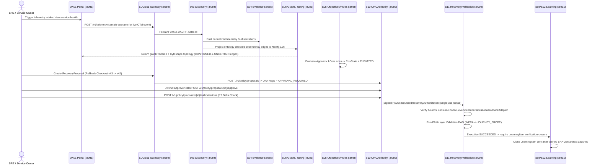

---

## SD-02: Two-Person Grant Approval & Principal Isolation (`S01`)
*Shows strict separation of duties between principal creation, independent human approval, and atomic single-use membership application behind `EDGE01`.*

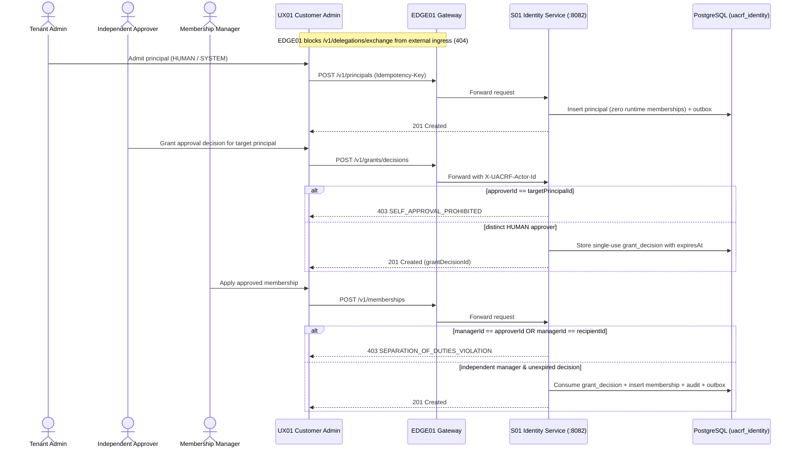

---

## SD-03: Telemetry Adapter SPI, `SAMPLE_LOCAL` Fixtures & `No-Synthetic-Fallback` Evidence Qualification (`S03`, `S04`)
*Contrasts isolated lab fixtures (`SAMPLE_LOCAL`) with empirical evidence qualification (`QualificationEngine`), blocking non-empirical substitutes and locking proof into WORM storage.*

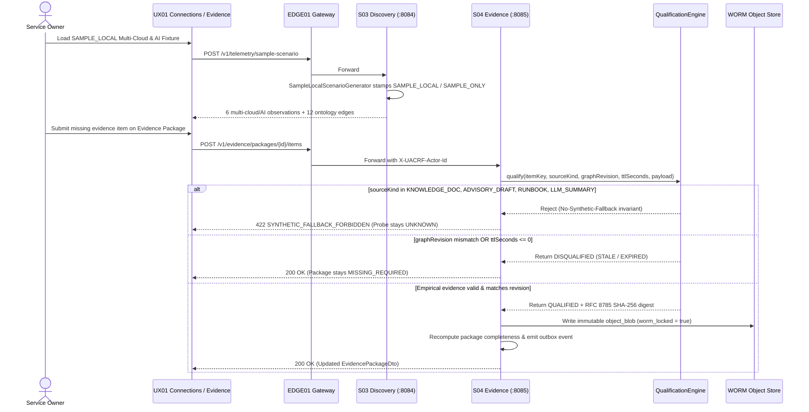

---

## SD-04: Sole Neo4j 5.26 Projection (`58` Labels / `55` Relationships) & Edge Confirmation (`S06`)
*Demonstrates schema validation (`Neo4jOntology`), atomic PostgreSQL revision tracking, Neo4j `MERGE` projection, and bounded dependency subgraph retrieval.*

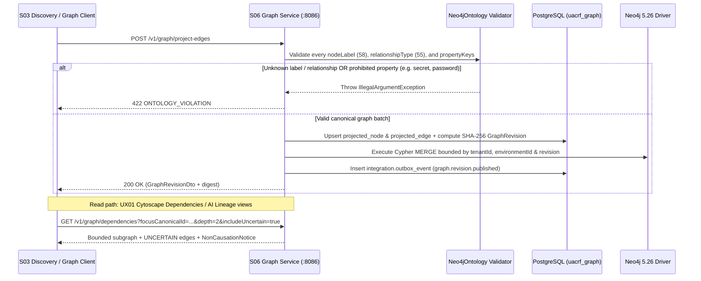

---

## SD-05: Journey Resilience Assessment, Path Independence (`P5`) & RS256 Envelope Replay (`P1`, `S07`)
*Captures cross-domain failover path checks (`P5`), independent reviewer separation, RS256 JWS envelope sealing (`P1`), and cryptographic tamper verification on replay.*

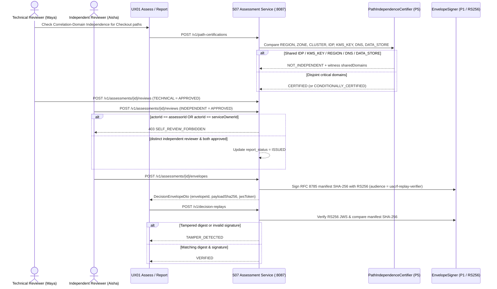

---

## SD-06: Continuous Rules (`S05`), OPA Evaluation, `P2` Graph Delta & `P3` Bounded Authorization (`S10`)
*Details rule triggering (`S05`), live OPA Rego policy gating, two-person approval, `P2` graph-delta invalidation, and short-lived single-use `P3` token issuance.*

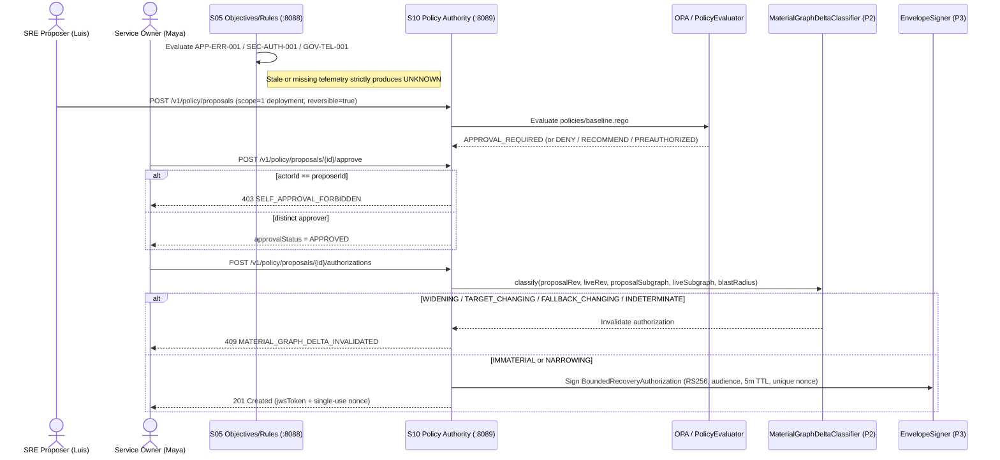

---

## SD-07: Recovery Execution, Allowlisted Adapters (`P3`), `P6` Cross-Layer Validation & Compensation (`S11`)
*Shows pre-execution kill-switch and nonce checks before calling bounded cloud/Kubernetes adapters and running the 8-layer P6 validation DAG with automatic saga compensation.*

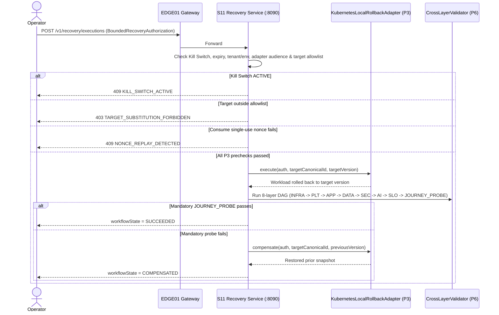

---

## SD-08: Solution-Specific Agent Advisors (`S09`), Prompt-Injection Firewall & `P7` Arbitration
*Illustrates prompt-injection filtering, token budget caps, PII scrubbing across OpenAI/Bedrock/Azure/Vertex/OCI LLMs, and permutation-invariant Critic dissent preservation.*

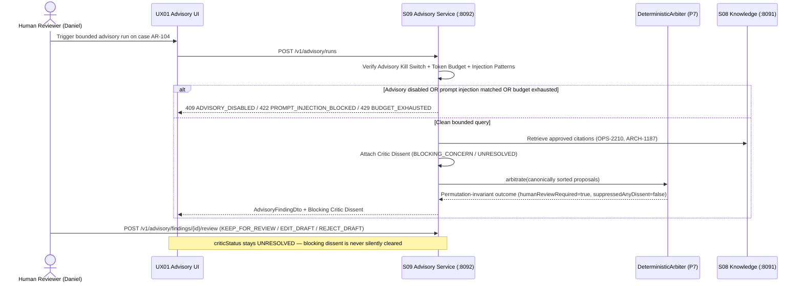

---

## Enterprise & Regulatory Compliance Sequence Diagrams (`Phase E1–E4 Scope`)

## SD-09: Enterprise Zero-Trust OIDC Login, Delegation Exchange & PostgreSQL RLS (`REG-SOC2`, `REG-ISO27001`, `REG-PRA`)
*Traces PKCE/MFA federation at `EDGE01`, internal 30-second RS256 delegation tokens, and PostgreSQL kernel Row-Level Security enforcement via `app.tenant_id`.*

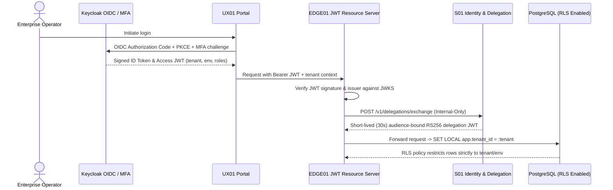

---

## SD-10: Async Kafka Outbox Relay, PII/PHI Scrubbing & S3 Object Lock WORM (`REG-GDPR`, `REG-HIPAA`, `REG-DORA`)
*Details atomic outbox publication to Kafka/Redpanda after pre-storage PII/PHI scrubbing, immutable S3 Object Lock persistence, and Neo4j reconciliation.*

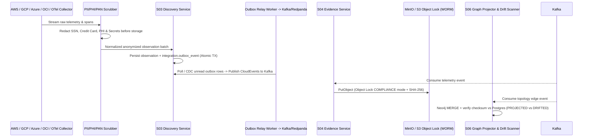

---

## SD-11: Temporal Durable Recovery Worker, Live OPA Bundle, KMS/FIPS Signing & Live Cluster (`REG-FEDRAMP`, `REG-PCI`, `REG-NERC`)
*Connects live OPA Rego policy evaluation, FIPS 140-3 / KMS envelope signing, Temporal durable activity workers, and bounded rollback/compensation.*

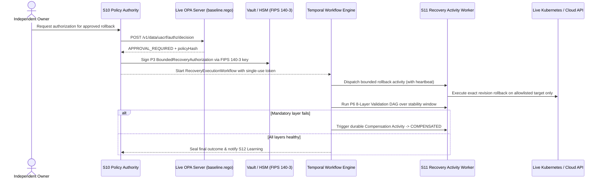

---

## SD-12: External Auditor Assurance Room, Regulatory Crosswalk Export (`S14`) & SSDF Provenance
*Follows CI supply-chain provenance (`CycloneDX`, `Trivy`, `CodeQL`, `Cosign`) into `S14` time-bound watermarked auditor rooms and multi-framework compliance exports.*

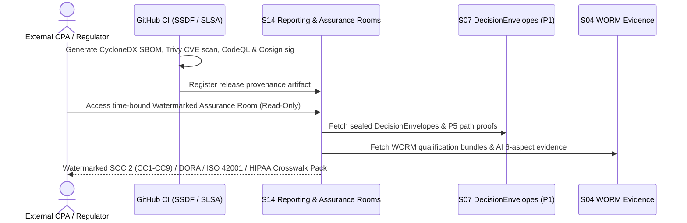

---

## SD-13: Four-Cloud Federated Discovery, Cross-Cloud Dependency Projection & Bounded Recovery (`GCP`, `AWS`, `Azure`, `OCI`)
*Demonstrates parallel read-only collection across GCP, AWS, Azure, and OCI, WORM storage, Neo4j failover path validation, and bounded multi-cloud action dispatch.*

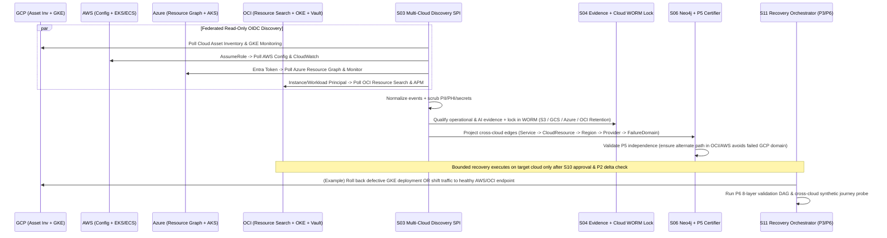
