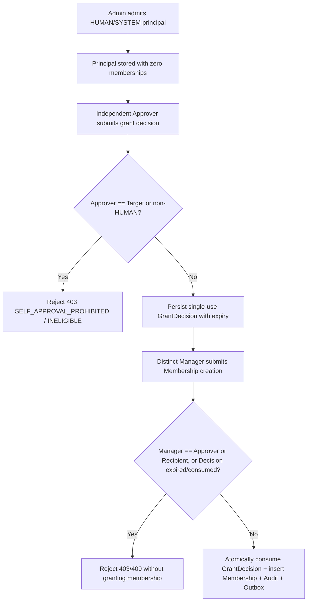
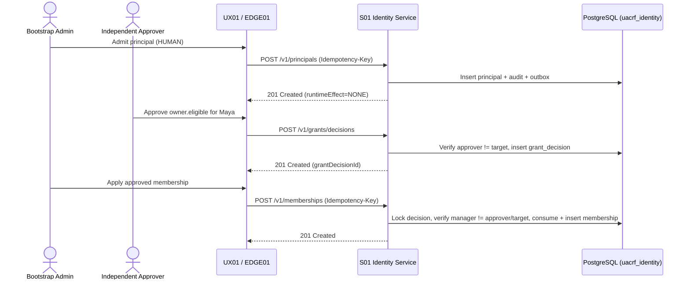
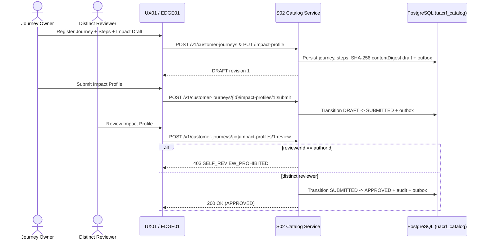

# Milestone 1 Activity & Sequence Diagrams

## 1. Two-Person Grant Approval & Delegation Exchange (Activity)

## 2. Two-Person Grant Approval & Delegation Exchange (Sequence)

## 3. Customer Journey & Impact Profile Review Lifecycle (Sequence)

