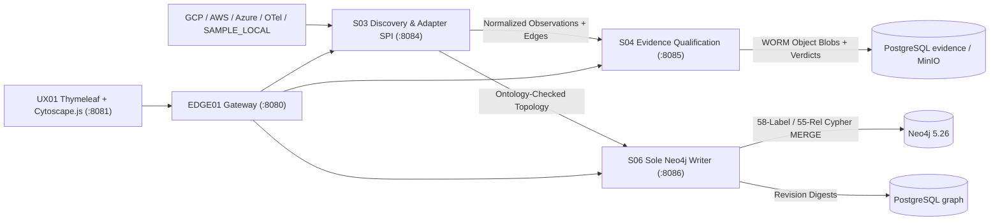
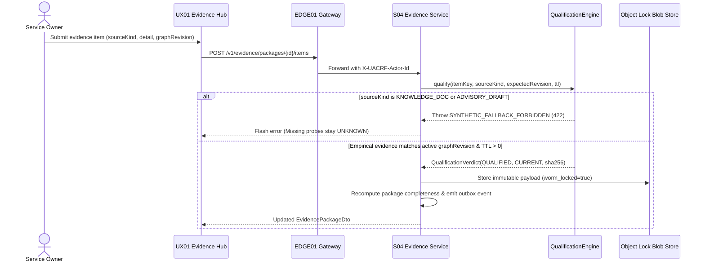
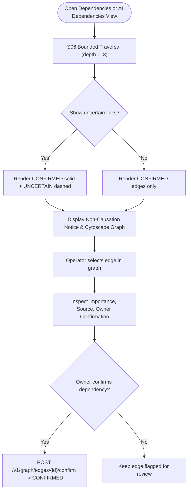
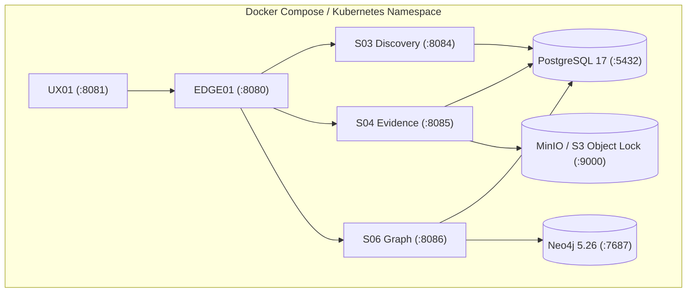

# Milestone 2 Architecture, Sequence, Activity & Deployment Diagrams

## 1. Ingestion, Qualification & Graph Projection Architecture

## 2. Evidence Qualification & No-Synthetic-Fallback Sequence Diagram

## 3. Dependency & AI Lineage Inspection Activity Diagram

## 4. Local & Target Deployment View (Milestone 2 Addition)

