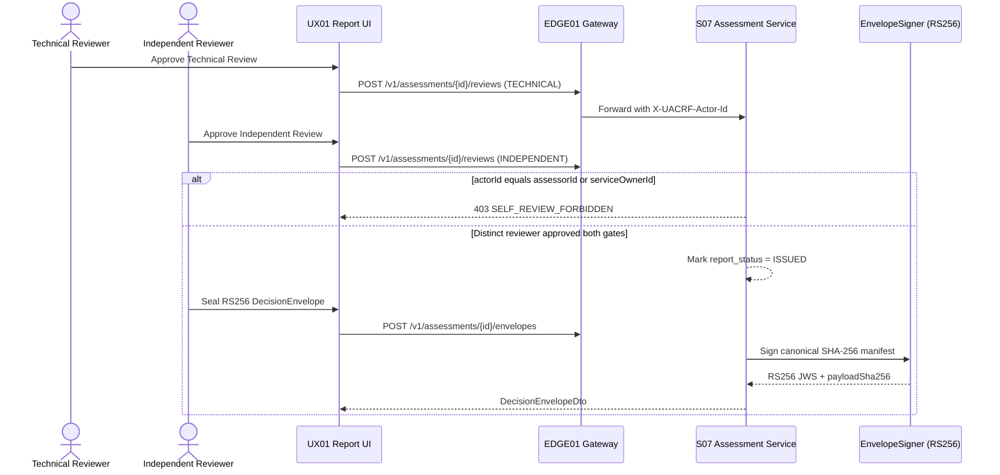
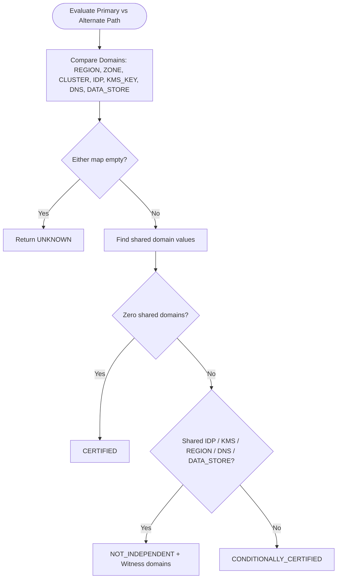

# Milestone 3 Flows — Assess, Path Independence (P5) & Sealed Envelopes (P1)

## 1. Assessment Review, Separation of Duties & P1 Sealing Sequence

## 2. Correlation-Domain Independence (P5) Activity Flow

